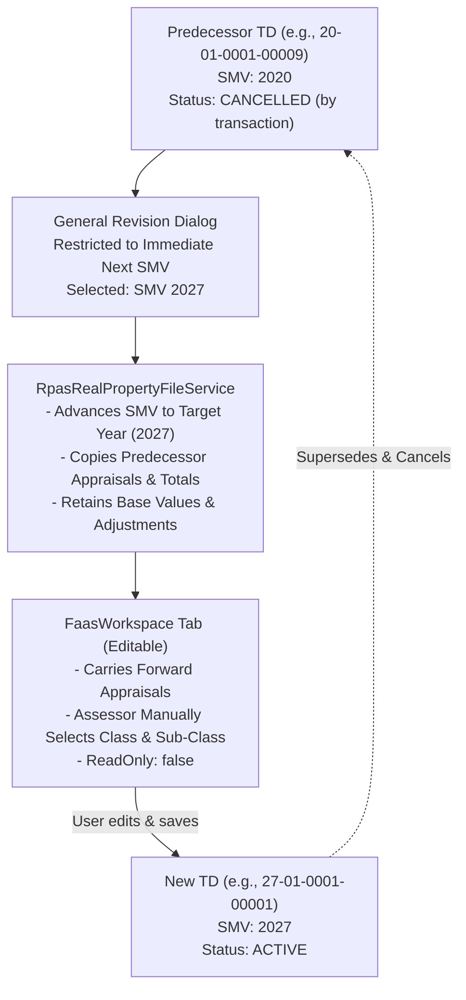

# RPAS General Revision (GR) & Schedule of Market Values (SMV) Specification

## 1. Overview & Business Context

In the Real Property Assessment System (RPAS), a **General Revision (`GR`, Transaction ID: 3)** is a standard $1 \rightarrow 1$ (One-to-One) transaction. It is executed periodically when a Local Government Unit (LGU) enacts an updated **Schedule of Market Values (SMV)** (e.g. transitioning from SMV 2020 to SMV 2027).

The primary purpose of a General Revision is to:
1. Transition property records and series to the immediate successor SMV (e.g., from `20` to `27`).
2. Copy forward predecessor appraisals and grand totals intact so that the assessor can manually review and select the appropriate class and sub-class to use in the new SMV.
3. Archive/cancel the predecessor Tax Declaration (`cancelled_by_transaction = true`) and issue a newly minted active Tax Declaration under the new SMV series (e.g., `27-XX-XXXXX`).

---

## 2. SMV Versioning & Progression Rules

1. **Strict Sequential Progression (No Jumping / No Version Skipping)**:
   A user can only perform a General Revision against the **immediate successor SMV** that directly links to the current SMV via `parent_id`:
   $$\text{target\_smv.parent\_id} = \text{current\_td.rpas\_smv\_id} \quad \text{and} \quad \text{target\_smv.status} = \text{'approved'}$$
   * Example: If the current TD belongs to **SMV 2008**, it can **ONLY** be revised to **SMV 2020** (whose `parent_id` is 2008). It **CANNOT jump** straight to **SMV 2027**.
   * Selecting past or equal SMV years is strictly disallowed.
   * Attempting to jump past intermediate SMV revisions is rejected with HTTP 422.
2. **Latest SMV Boundary**:
   If an SMV has `is_latest = true` (or has no approved successor SMV with `parent_id = smv.id`), no General Revision can be initiated. Properties in this SMV are marked with status **"Latest SMV"** and cannot be selected for General Revision.
3. **Approved Status Only**: Only SMVs with status `approved` in `rpas_smvs` are presented as selectable options.
4. **Immutability of Historical TD Records**: The predecessor TD is never modified in-place. Its status transitions to `cancelled` with `cancelled_by_transaction = true`, and a link is established in `rpas_relationships`.

---

## 3. Database Schema & Data Models

### 3.1 `rpas_smvs`
Defines the Schedule of Market Value revisions:
* `id`: Primary key
* `code`: 2-digit SMV code used in TD numbering prefixes (e.g. `'20'` for 2020, `'27'` for 2027)
* `name`: Revision label (e.g. `'2027 SMV'`)
* `year`: Effective 4-digit calendar year (e.g. `'2027'`)
* `parent_id`: Foreign key referencing predecessor `rpas_smvs.id` (defines linear version lineage: 1981 $\rightarrow$ 1996 $\rightarrow$ 2008 $\rightarrow$ 2020 $\rightarrow$ 2027)
* `is_latest`: Boolean flag indicating whether this is the latest approved SMV series
* `status`: Approval state (`'approved'`, `'pending'`)

### 3.2 `rpas_appraisal_categories`
Stores the official schedule unit values per combination of Kind, Class, Sub-Class, and SMV:
* `rpas_smv_id`: Foreign key to `rpas_smvs`
* `rpas_kind_id`: 1 (Land), 2 (Building), 3 (Machinery), 4 (Plants & Trees)
* `rpas_class_id`: Foreign key to `rpas_classes`
* `rpas_sub_class_id`: Foreign key to `rpas_sub_classes`
* `rpas_subdivision_id`: Nullable foreign key for subdivision-specific rates
* `unit_value`: Base rate per square meter or unit (decimal: 12, 2)

### 3.3 SMV-Dependent Auxiliaries
For a new SMV to support comprehensive property editing and calculation, the following configuration tables must contain corresponding records for that SMV:
* `rpas_assessment_smvs`: Assessment level % per actual use for that SMV.
* `rpas_stripping_smvs`: Standard land stripping percentages.
* `rpas_road_type_smvs`: Road proximity adjustment percentages.
* `rpas_influence_type_smvs`: Land influence factors (positive/negative adjustments).
* `rpas_depreciations`: Building depreciation schedules and formulas.
* `rpas_extra_item_smvs`: Building extra items base rates.

---

## 4. Appraisal Handling (Simplified Copy-Forward Process)

To ensure operational efficiency and eliminate automatic calculation discrepancies during SMV migration, the General Revision process is simplified:

### 4.1 Copy-Forward Mechanism
Instead of automatically force-matching and recalculating unit values against the new SMV's schedule categories:
1. **Direct Appraisal Replication**: All previous appraisal records (`appraisals` and `plants_and_trees`) are carried over intact from the predecessor Tax Declaration.
2. **Preserved Figures**: Area, unit value, base market value, stripping and road adjustments, adjusted market value, assessment level, and assessed value remain identical to the predecessor record upon initial generation.
3. **Manual Class & Sub-Class Selection**: The user manually selects the desired class and sub-class to apply from the target SMV within the FAAS workspace, recalculating or adjusting lines as necessary.

### 4.2 Formula Reference (When Recalculating Manually)
When an assessor edits class, sub-class, or adjustments in the workspace, standard RPAS valuation formulas apply:

$$\text{Base Market Value (BMV)} = \text{Area} \times \text{Unit Value}$$

$$\text{Net Base Market Value} = \text{BMV} + \left(\text{BMV} \times \frac{\text{Stripping Rate} - 100}{100}\right)$$

$$\text{Adjusted Market Value} = \text{Net BMV} \times \left(1 + \text{Influence \%} + \text{Road Type \%} + \text{Distance Factors}\right)$$

$$\text{Assessed Value} = \text{Adjusted Market Value} \times \left(\frac{\text{Assessment Level \%}}{100}\right)$$

$$\text{Total Market Value} = \sum \text{Adjusted Market Value}$$

$$\text{Total Assessed Value} = \sum \text{Assessed Value}$$

---

## 5. API Specification

### Endpoint: Retrieve General Revision Preview
* **Method**: `GET`
* **Route**: `/api/rpas/real-property-files/general-revision/{id}`
* **Query Parameters**:
  * `target_smv_id` (*required, integer*): Target approved SMV ID.
* **Success Response (`200 OK`)**:
  Returns the complete Tax Declaration data structure identical to `/api/rpas/real-property-files/get-tax-declaration/{id}`, with:
  * `smv_id` updated to `target_smv_id`.
  * `rpas_smv` populated with target SMV details.
  * `effectivity_year` initialized to target SMV effective year.
  * `appraisals` and `plants_and_trees` directly copied forward from the predecessor record.
  * `total_market_value` and `total_assessed_value` preserved from predecessor totals.
  * `is_validated` and `is_approved` set to `false` (`validated_date` and `approved_date` set to `null`).

---

## 6. Frontend UI / UX Flow

1. In `TransactionMenu.jsx`, clicking **GR - General Revision** launches `GeneralRevisionDialog`.
2. `GeneralRevisionDialog` locks selection to the immediate successor SMV (`next_smv_id` / `parent_id = current_td.smv_id`):
   * If current SMV is latest or has no successor, an alert informs the user that General Revision cannot proceed.
3. Upon clicking **Proceed**:
   * A new tab is created in `FaasWorkspace` in loading state.
   * The General Revision preview endpoint is fetched.
   * `transformFaasData` applies transaction transformation:
     * `id`: `null` (indicates new declaration)
     * `tempId`: newly generated UUID
     * `rpas_transaction_id`: `3` (`GR`)
     * `readOnly`: `false` (interactive edit mode)
     * `is_validated`: `false`
     * `is_approved`: `false`
     * `previous_td_id`: `[current_td.id]`
     * `previous_td_number`: `current_td.td_no`
     * `appraisals`: existing appraisal IDs removed so fresh entries are persisted.
4. The user reviews the copied appraisals in `FaasWorkspace` and manually selects the class and sub-class for the new SMV.
5. Clicking **Save** persists the new TD via `POST /api/rpas/create-tax-declaration` (`StoreTaxDec`), retiring the predecessor and assigning a new TD number in the new SMV series.
