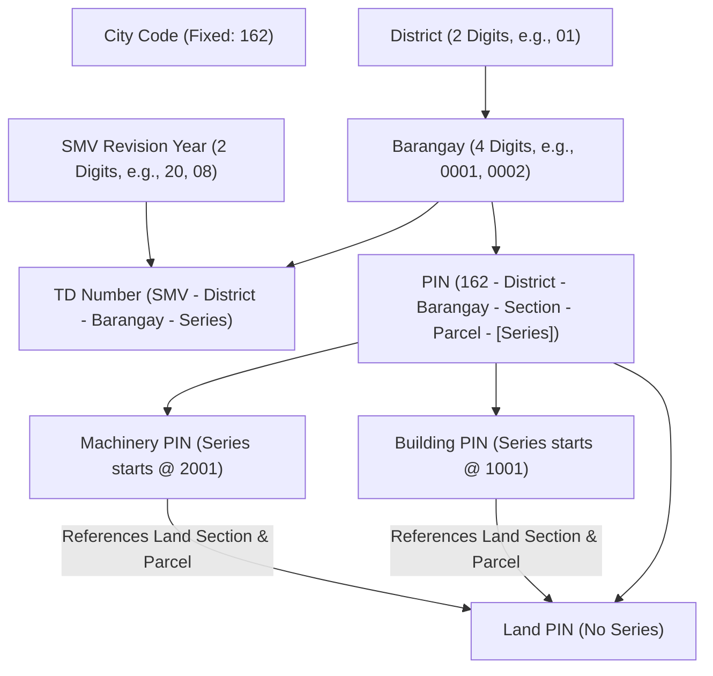
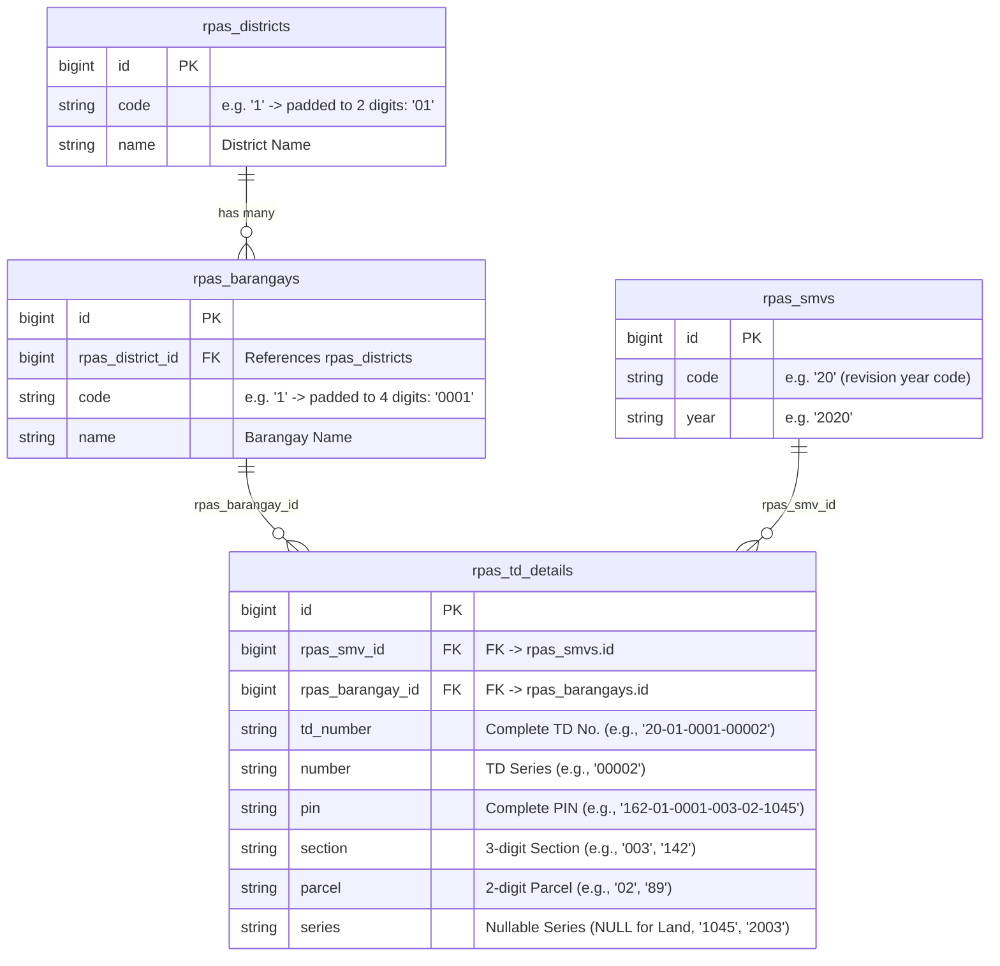

# RPAS Numbering & Location Relationships Specification

This document details the structure, format, hierarchy, and relationships among **District**, **Barangay**, **SMV (Schedule of Market Values)**, **Tax Declaration Number (TD No.)**, and **Property Identification Number (PIN)** in the Real Property Assessment System (RPAS).

---

## 1. Overview & Hierarchy

In RPAS, every real property record is bound by administrative location codes (District and Barangay) and assessment revision rules (SMV). These components build the structured identifiers used for tax mapping and property administration.



---

## 2. Location & SMV Components

### 2.1 District & Barangay Hierarchy
* **District**: Top-level administrative division within the municipality/city.
  * **Code Format**: **2 digits** (e.g., `01`, `02`).
* **Barangay**: Sub-division contained within a specific district.
  * **Code Format**: **4 digits** (e.g., `0001` for Agao, `0002` for Ampayon).
* **Barangay Display Format**: When displaying a Barangay identifier, it must always incorporate its parent District code:
  $$\text{District Code (2 digits)} - \text{Barangay Code (4 digits)}$$

#### Examples:
| District | Barangay Name | District Code | Barangay Code | Full Barangay Display Code |
| :--- | :--- | :--- | :--- | :--- |
| District 1 | Agao | `01` | `0001` | `01-0001` |
| District 1 | Ampayon | `01` | `0002` | `01-0002` |

---

### 2.2 Schedule of Market Values (SMV)
* Represents the general assessment revision period/year.
* **Code Format**: **2 digits** representing the revision year (last 2 digits of the year).

#### Examples:
* Year `2020` $\rightarrow$ SMV Code `20`
* Year `2008` $\rightarrow$ SMV Code `08`

---

## 3. Tax Declaration (TD) Number

### 3.1 Format Specification
The TD Number is constructed by combining the SMV code, District code, Barangay code, and a sequential series number:

$$\mathbf{\text{SMV}} - \mathbf{\text{District}} - \mathbf{\text{Barangay}} - \mathbf{\text{Series}}$$
$$\text{[2 digits]} - \text{[2 digits]} - \text{[4 digits]} - \text{[5 digits]}$$

---

### 3.2 Series Increment Rules
1. **Scope**: The series counter is tracked independently per **SMV + Barangay** combination.
2. **Padding**: The series is padded to **5 digits** (e.g., `00001`, `00002`).
3. **Property Kind Neutral**: The series increments sequentially regardless of whether the TD is created for Land, Building, or Machinery.
4. **Independence**: Different SMV years or different Barangays maintain their own separate series counts starting from `00001`.

---

### 3.3 Concrete Examples of TD Numbers

| Scenario | SMV Year (Code) | District | Barangay (Code) | Series | Formatted TD Number |
| :--- | :--- | :--- | :--- | :--- | :--- |
| **1st TD in Ampayon (2020 SMV)** | 2020 (`20`) | `01` | Ampayon (`0002`) | 1 | `20-01-0002-00001` |
| **2nd TD in Ampayon (2020 SMV)** | 2020 (`20`) | `01` | Ampayon (`0002`) | 2 | `20-01-0002-00002` |
| **1st TD in Agao (2020 SMV)** | 2020 (`20`) | `01` | Agao (`0001`) | 1 | `20-01-0001-00001` |
| **5th TD in Agao (2008 SMV)** | 2008 (`08`) | `01` | Agao (`0001`) | 5 | `08-01-0001-00005` |

---

### 3.4 Database Storage Mapping (`rpas_td_details`)
The TD Number components and assembled values are stored in the primary **`rpas_td_details`** table:

* **Complete TD Number (`td_number`)**: Stores the full assembled string (e.g., `'20-01-0001-00002'`).
* **TD Series (`number`)**: Stores the sequential counter number for the TD series (e.g., `'00002'`).
* **SMV (`rpas_smv_id`)**: Foreign key referencing the `id` of `rpas_smvs`.
  * The SMV prefix (`20` in `20-01-0001-00002`) is sourced from the `code` column in the **`rpas_smvs`** table.
* **Barangay & District (`rpas_barangay_id`)**: Foreign key referencing the `id` of `rpas_barangays`.
  * The `rpas_barangays` table is linked to `rpas_districts` via `rpas_district_id`.
  * Both tables have a `code` column used to build the `01-0001` segment:
    * **District Code**: Sourced from `rpas_districts.code` (e.g., `'1'`), padded to **2 digits** $\rightarrow$ `01`.
    * **Barangay Code**: Sourced from `rpas_barangays.code` (e.g., `'1'`), padded to **4 digits** $\rightarrow$ `0001`.

---

## 4. Property Identification Number (PIN)

### 4.1 Format Specification & Base Components
The PIN uniquely identifies physical properties on the tax map. 

$$\mathbf{162} - \mathbf{\text{District}} - \mathbf{\text{Barangay}} - \mathbf{\text{Section}} - \mathbf{\text{Parcel}} [ - \mathbf{\text{Series}} ]$$

* `162`: Fixed City/Municipality Code (e.g., Butuan City).
* `District`: **2 digits** (e.g., `01`).
* `Barangay`: **4 digits** (e.g., `0002`).
* `Section`: **3 digits** tax map section number (range: 1 to 999; e.g., `002`, `010`).
* `Parcel`: **2 digits** parcel/lot number within the section (range: 1 to 99; e.g., `04`, `03`).
* `Series`: Optional **4-digit** suffix present only for Improvements (Building & Machinery).

> [!NOTE]
> * **Section** is displayed in 3 digits because the section range spans from **1 to 999** (e.g., `001`–`999`).
> * **Parcel** is displayed in 2 digits because the parcel range spans from **1 to 99** (e.g., `01`–`99`).

---

### 4.2 PIN Rules by Property Kind

```
┌────────────────────────────────────────────────────────────────────────┐
│                        PIN STRUCTURE BY KIND                           │
├──────────┬─────────────────────────────────────────────────────────────┤
│ LAND     │ 162 - District - Barangay - Section - Parcel                │
│          │ Example: 162-01-0002-010-03                                 │
├──────────┼─────────────────────────────────────────────────────────────┤
│ BUILDING │ 162 - District - Barangay - Section - Parcel - Series (1000s)│
│          │ Example: 162-01-0002-010-03-1023                            │
├──────────┼─────────────────────────────────────────────────────────────┤
│ MACHINERY│ 162 - District - Barangay - Section - Parcel - Series (2000s)│
│          │ Example: 162-01-0002-003-01-2001                            │
└──────────┴─────────────────────────────────────────────────────────────┘
```

1. **Land PIN (No Series)**:
   * Defined purely by location: Section and Parcel numbers.
   * Does **not** contain a series suffix.
   * *Example*: `162-01-0002-002-04` or `162-01-0002-010-03`.

2. **Building PIN (Series starts at `1001`)**:
   * Uses a 4-digit series starting from `1001` (e.g., `1001`, `1002`, `1023`).
   * *Example*: `162-01-0002-010-03-1023`.

3. **Machinery PIN (Series starts at `2001`)**:
   * Uses a 4-digit series starting from `2001` (e.g., `2001`, `2002`).
   * *Example*: `162-01-0002-003-01-2001`.

---

### 4.3 Land Reference Relationship
Buildings and Machinery exist physically on top of a specific piece of Land. The PIN design reflects this direct spatial dependency:

* The **Section** (`010`) and **Parcel** (`03`) digits inside a Building or Machinery PIN **directly reference** the Land PIN where that improvement is located.

#### Structural Breakdown Example:

```
HOST LAND PIN:          162 - 01 - 0002 - 010 - 03
                        │     │    │      │     └─ Parcel (03)
                        │     │    │      └─────── Section (010)
                        │     │    └────────────── Barangay (0002 = Ampayon)
                        │     └─────────────────── District (01)
                        └───────────────────────── Fixed City Code (162)

BUILDING ON THAT LAND:  162 - 01 - 0002 - 010 - 03 - 1023
                                          └───┬───┘   └─── Building Series #23 (Starts at 1001)
                                              └────── References Host Land Parcel (010-03)

MACHINERY ON THAT LAND: 162 - 01 - 0002 - 010 - 03 - 2005
                                          └───┬───┘   └─── Machinery Series #5 (Starts at 2001)
                                              └────── References Host Land Parcel (010-03)
```

---

### 4.4 Database Storage Mapping (`rpas_td_details`)
PIN attributes and assembled values are stored directly in **`rpas_td_details`**:

* **Complete PIN (`pin`)**: Stores the full assembled PIN string (e.g., `'162-01-0002-003-02'` or `'162-01-0002-003-02-1045'`).
* **Section (`section`)**: Stored already in **3-digit** form (e.g., `'003'`, `'142'`).
* **Parcel (`parcel`)**: Stored already in **2-digit** form (e.g., `'02'`, `'89'`).
* **Series (`series`)**: **Nullable** column:
  * `NULL` for **Land** (Land PIN has no series).
  * Populated for **Improvements**:
    * **Building**: e.g., `'1045'` (Building series in the 1000s).
    * **Machinery**: e.g., `'2003'` (Machinery series in the 2000s).

---

## 5. Database Schema & Persistence Architecture

The general details of a Tax Declaration, its TD Number, and its PIN are persisted in **`rpas_td_details`**, connecting to administrative references as follows:



### Table Column Summary for TD and PIN

| Target Field | Table | Column | Nullable | Stored / Display Example | Derivation / Source Notes |
| :--- | :--- | :--- | :---: | :--- | :--- |
| **Complete TD No.** | `rpas_td_details` | `td_number` | No | `'20-01-0001-00002'` | Assembled SMV + District + Barangay + Series |
| **TD Series Counter**| `rpas_td_details` | `number` | No | `'00002'` | Sequential 5-digit padded counter per SMV + Barangay |
| **SMV Reference** | `rpas_td_details` | `rpas_smv_id` | No | `1` | Foreign key to `rpas_smvs.id`. Derives SMV prefix from `rpas_smvs.code` (e.g., `'20'`) |
| **Barangay Reference**| `rpas_td_details`| `rpas_barangay_id`| No | `1` | Foreign key to `rpas_barangays.id`. Connected to `rpas_districts` to derive `01-0001` |
| **District Code** | `rpas_districts` | `code` | No | `'1'` $\rightarrow$ `'01'` | Padded to 2 digits for TD and PIN display |
| **Barangay Code** | `rpas_barangays` | `code` | No | `'1'` $\rightarrow$ `'0001'` | Padded to 4 digits for TD and PIN display |
| **Complete PIN** | `rpas_td_details` | `pin` | Yes | `'162-01-0002-003-02-1045'` | Full assembled PIN |
| **PIN Section** | `rpas_td_details` | `section` | Yes | `'003'`, `'142'` | Stored directly in 3-digit format |
| **PIN Parcel** | `rpas_td_details` | `parcel` | Yes | `'02'`, `'89'` | Stored directly in 2-digit format |
| **PIN Series** | `rpas_td_details` | `series` | Yes | `NULL`, `'1045'`, `'2003'` | `NULL` for Land; Building (`1001+`), Machinery (`2001+`) |

---

## 6. Summary Cheat Sheet

| Identifier | Format Pattern | Segment Lengths | Example | Database Column (`rpas_td_details`) |
| :--- | :--- | :--- | :--- | :--- |
| **District** | `[District]` | 2 digits | `01` | Sourced via `rpas_barangay_id` $\rightarrow$ `rpas_districts.code` (pad 2) |
| **Barangay Display** | `[District]-[Barangay]` | 2 - 4 digits | `01-0002` | Sourced via `rpas_barangay_id` $\rightarrow$ `rpas_barangays.code` (pad 4) |
| **SMV Code** | `[Year]` | 2 digits | `20` | Sourced via `rpas_smv_id` $\rightarrow$ `rpas_smvs.code` |
| **TD Number** | `[SMV]-[Dist]-[Brgy]-[Series]` | 2 - 2 - 4 - 5 digits | `20-01-0002-00001` | `td_number` (series in `number`) |
| **Land PIN** | `162-[Dist]-[Brgy]-[Sec]-[Parcel]` | 3 - 2 - 4 - 3 - 2 digits | `162-01-0002-010-03` | `pin` (`section` = `'010'`, `parcel` = `'03'`, `series` = `NULL`) |
| **Building PIN** | `162-[Dist]-[Brgy]-[Sec]-[Parcel]-[Series]` | 3 - 2 - 4 - 3 - 2 - 4 digits | `162-01-0002-010-03-1023` | `pin` (`section` = `'010'`, `parcel` = `'03'`, `series` = `'1023'`) |
| **Machinery PIN** | `162-[Dist]-[Brgy]-[Sec]-[Parcel]-[Series]` | 3 - 2 - 4 - 3 - 2 - 4 digits | `162-01-0002-003-01-2001` | `pin` (`section` = `'003'`, `parcel` = `'01'`, `series` = `'2001'`) |
