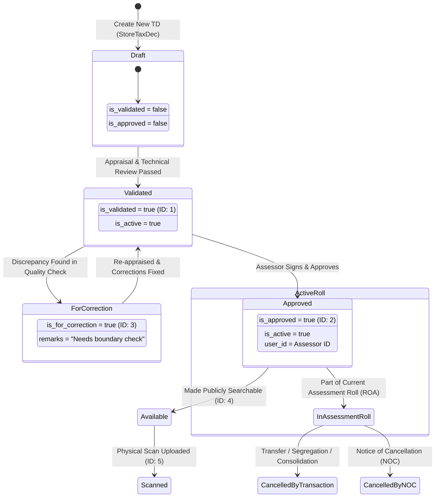

# RPAS Tax Declaration (TD) Status & Sub-Status Architecture

This document provides the authoritative architecture and business specification for **Tax Declaration (TD) Statuses and Sub-Statuses** in the Real Property Assessment System (RPAS). It explains the two-tier status design, database schema, Eloquent model helpers, state transitions, and standard query filtering patterns used across reports and transaction workflows.

---

## 1. Architectural Overview: Two-Tier Status Model

In RPAS, a Tax Declaration record possesses two distinct and orthogonal status layers:

```
┌─────────────────────────────────────────────────────────────────────────────────┐
│                           RPAS TAX DECLARATION RECORD                           │
│                                                                                 │
│   1. PRIMARY ASSESSMENT LIFECYCLE STATUS                                        │
│      Table: rpas_tax_declaration_statuses -> rpas_statuses                      │
│      "Is this TD currently legally in effect on the roll, or cancelled?"        │
│      Values: ACTIVE (1) | CANCELLED (2)                                         │
│                                                                                 │
│   2. WORKFLOW PROGRESS SUB-STATUS                                               │
│      Table: rpas_td_sub_statuses -> rpas_sub_status                             │
│      "Where is this TD in the encoding, verification, and approval pipeline?"   │
│      Values: is_validated (1) | is_approved (2) | is_for_correction (3) | ...   │
└─────────────────────────────────────────────────────────────────────────────────┘
```

| Dimension | Primary Lifecycle Status | Workflow Progress Sub-Status |
| :--- | :--- | :--- |
| **Database Table** | `rpas_tax_declaration_statuses` linked to `rpas_statuses` | `rpas_td_sub_statuses` linked to `rpas_sub_status` |
| **Scope** | Legal validity & roll standing (Assessment vs. Cancelled Roll) | Administrative progress, quality control, and approval audit trail |
| **Cardinality** | Typically 1 active lifecycle row per TD (`latestOfMany`) | 1-to-$N$ sub-status event rows with active/inactive flags (`is_active`) |
| **Key States** | `ACTIVE` (`id=1`), `CANCELLED` (`id=2`) | `is_validated` (`1`), `is_approved` (`2`), `is_for_correction` (`3`), etc. |
| **Cancellation Context** | Distinguishes *Cancelled by Transaction* from *Cancelled by NOC* | Not applicable to cancelled records (approval stops at cancellation) |

---

## 2. Primary Assessment Lifecycle Status

The primary lifecycle status defines whether a Tax Declaration is in force on the active **Assessment Roll (Roll of Assessment - ROA)** or archived in the **Cancelled Roll (Roll of Cancelled Assessment - RCA)**.

### 2.1 Master Status Reference (`rpas_statuses`)

The master lookup table `rpas_statuses` contains the immutable system lifecycle codes:

| ID | Code | Name | Description |
| :-: | :--- | :--- | :--- |
| `1` | `active` | `ACTIVE` | The Tax Declaration is legally active and enforceable for real property tax assessment. |
| `2` | `cancelled` | `CANCELLED` | The Tax Declaration has ceased to be active, superseded either by a transaction or cancelled permanently by a Notice of Cancellation. |

### 2.2 Status Tracking Table (`rpas_tax_declaration_statuses`)

Every lifecycle status event for a TD is recorded in `rpas_tax_declaration_statuses`:

```sql
CREATE TABLE `rpas_tax_declaration_statuses` (
  `id` BIGINT UNSIGNED AUTO_INCREMENT PRIMARY KEY,
  `rpas_status_id` BIGINT UNSIGNED NOT NULL,       -- Foreign key to rpas_statuses
  `rpas_td_detail_id` BIGINT UNSIGNED NOT NULL,     -- Foreign key to rpas_td_details
  `cancelled_by_id` BIGINT UNSIGNED NULL,          -- User ID of assessor cancelling the TD
  `cancelled_date` VARCHAR(255) NULL,              -- Cancellation date string (YYYY-MM-DD)
  `cancelled_by_transaction` TINYINT(1) DEFAULT 0, -- TRUE if cancelled by TR/SE/CS/GR
  `rpas_noc_reason_id` BIGINT UNSIGNED NULL,       -- Foreign key to rpas_noc_reasons
  `reason_code` VARCHAR(255) NULL,                 -- Specific reason code string
  `reason` VARCHAR(255) NULL,                      -- Assessment cessation explanation
  `others` VARCHAR(255) NULL,                      -- Extended cancellation remarks
  `tax_cease_year` VARCHAR(255) NULL,              -- Tax year liability ceases
  `being_exempted_since` VARCHAR(255) NULL,        -- Year property gained tax exemption
  `quarter` VARCHAR(255) NULL,                     -- Quarter when liability ceased
  `created_at` TIMESTAMP NULL,
  `updated_at` TIMESTAMP NULL,
  `deleted_at` TIMESTAMP NULL
);
```

### 2.3 System Cancellation Modes

When `rpas_status_id = 2` (`cancelled`), the system identifies how and why the TD was cancelled:

1. **Cancelled by Transaction (`cancelled_by_transaction = true`)**:
   - The TD was replaced or altered by a standard assessment transaction (Transfer `TR`, Segregation `SE`, Consolidation `CS`, General Revision `GR`, Reassessment `RA`, etc.).
   - Predecessor and successor TDs are linked via `superseded_td_id` or `rpas_relationships`.
   - The predecessor TD enters the Cancelled Roll while new successor TD(s) become `ACTIVE`.

2. **Cancelled by Notice of Cancellation (`cancelled_by_transaction = false` or `rpas_noc_reason_id IS NOT NULL`)**:
   - The TD was cancelled permanently without a successor TD (e.g., duplicated entry, erroneous declaration, court judgment, total erosion/destruction).
   - Associated with a Notice of Cancellation control document in `rpas_nocs` / `rpas_noc_reasons`.
   - For complete details on NOC mechanics, see [`rpas_transaction_processes.md`](file:///c:/Users/Administrator/Desktop/RPAS/Development/docs/architecture/rpas_transaction_processes.md#6-system-wide-detection-rule-cancelled-by-transaction-vs-notice-of-cancellation).

---

## 3. Workflow Progress Sub-Statuses

Workflow sub-statuses track the multi-step quality control, validation, and administrative sign-off process that every TD undergoes from initial draft encoding to official release.

### 3.1 Architecture Evolution & Flag Migration

> [!NOTE]
> In early schema revisions, sub-statuses existed as flat boolean flags on `rpas_td_details` (`is_validated`, `is_approved`, `is_for_correction`, `date_approved`, `approved_by_id`).  
> These flat columns were migrated to the dedicated table `rpas_td_sub_statuses` to support:
> 1. Multi-state audit trails (recording who updated each milestone and when).
> 2. Specific per-step remarks (e.g. revision notes for `is_for_correction`).
> 3. State activation toggling via the `is_active` boolean column.

### 3.2 Master Sub-Status Codes (`rpas_sub_status`)

The lookup table `rpas_sub_status` defines the system workflow milestones:

| ID | Code | Name | Workflow Meaning & Requirements |
| :-: | :--- | :--- | :--- |
| `1` | `is_validated` | `Validated` | Property boundaries, appraisals, and technical descriptions have been inspected and confirmed by technical appraisal staff. |
| `2` | `is_approved` | `Approved` | The Tax Declaration has been officially reviewed and signed by the City/Municipal Assessor or authorized signatory. |
| `3` | `is_for_correction`| `For Correction` | Flaws or discrepancies were detected; sent back to appraisal/encoding with specific correction remarks in `remarks`. |
| `4` | `is_available` | `Available` | The assessment record has been finalized, released, and made available for public records and billing. |
| `5` | `is_scanned` | `Scanned` | The physical signed hardcopy of the Tax Declaration document has been scanned and digitally archived. |

### 3.3 Sub-Status Entity Table (`rpas_td_sub_statuses`)

```sql
CREATE TABLE `rpas_td_sub_statuses` (
  `id` BIGINT UNSIGNED AUTO_INCREMENT PRIMARY KEY,
  `rpas_td_detail_id` BIGINT UNSIGNED NOT NULL,  -- Foreign key to rpas_td_details
  `rpas_sub_status_id` BIGINT UNSIGNED NOT NULL, -- Foreign key to rpas_sub_status
  `is_active` TINYINT(1) DEFAULT 0,              -- Whether this sub-status is currently in effect
  `remarks` VARCHAR(255) NULL,                   -- Correction notes or milestone remarks
  `user_id` BIGINT UNSIGNED NULL,                -- User ID of appraiser/assessor who applied state
  `created_at` TIMESTAMP NULL,
  `updated_at` TIMESTAMP NULL
);
```

### 3.4 Workflow State Lifecycle



---

## 4. Eloquent Models & Helper Accessors

The Laravel backend encapsulates status logic inside Eloquent models in [`casd-api`](file:///c:/Users/Administrator/Desktop/RPAS/Development/casd-api).

### 4.1 Relationships on `RpasTdDetail`

In [`App\Models\Rpas\RpasTdDetail\RpasTdDetail`](file:///c:/Users/Administrator/Desktop/RPAS/Development/casd-api/app/Models/Rpas/RpasTdDetail/RpasTdDetail.php):

```php
// Primary Lifecycle Statuses
public function status(): HasMany
{
    return $this->hasMany(RpasTaxDeclarationStatus::class, 'rpas_td_detail_id');
}

public function currentStatus(): HasOne
{
    return $this->hasOne(RpasTaxDeclarationStatus::class, 'rpas_td_detail_id')
        ->latestOfMany();
}

// Workflow Sub-Statuses
public function subStatuses(): HasMany
{
    return $this->hasMany(RpasTdSubStatus::class);
}
```

### 4.2 Dynamic Accessors & Scopes

To provide backward compatibility and clean developer ergonomics, `RpasTdDetail` provides dynamic accessors:

```php
// Resolves active sub-status row without trigger extra queries if eager-loaded
private function activeSubStatus(string $code): ?RpasTdSubStatus
{
    return $this->subStatuses
        ->first(fn($s) => $s->is_active && $s->rpasSubStatus?->code === $code);
}

// Accessors:
$td->is_validated;           // bool (true if sub-status 1 is active)
$td->is_approved;            // bool (true if sub-status 2 is active)
$td->is_for_correction;      // bool (true if sub-status 3 is active)
$td->is_available;           // bool (true if sub-status 4 is active)
$td->is_scanned;             // bool (true if sub-status 5 is active)
$td->progress_status;        // 'Approved' | 'Validated' | 'Unvalidated'
$td->validated_date;         // 'YYYY-MM-DD' from sub-status 1 created_at
$td->date_approved;          // 'YYYY-MM-DD' from sub-status 2 created_at
$td->approved_by_id;         // int|null from sub-status 2 user_id
$td->is_for_correction_remarks; // string|null remarks

// Query Scopes:
RpasTdDetail::hasActiveSubStatus('is_approved')->get();
RpasTdDetail::validated()->get();
RpasTdDetail::available()->get();
RpasTdDetail::forCorrection()->get();
```

---

## 5. Report Filtering & Status Resolution Standards

Reporting modules in RPAS allow users to choose between two operational reporting modes:
1. **Approved Mode** (`status = 'approved'` or `is_approved = true`): Filters TDs that have achieved final assessor approval.
2. **Validated Mode** (`status = 'validated'` or `is_validated = true`): Filters TDs that have passed appraisal validation, including those pending final assessor sign-off.

### 5.1 Mode Resolution Rule

Backend services must resolve the status parameters using this standard convention:

```php
// Status mode resolution: 'approved' (default) vs. 'validated'
$statusMode = ($request->boolean('is_validated') || $request->input('status') === 'validated')
    ? 'validated'
    : 'approved';

$subStatusId   = ($statusMode === 'validated') ? 1 : 2;
$subStatusCode = ($statusMode === 'validated') ? 'is_validated' : 'is_approved';
```

### 5.2 Application by Report Type

#### 1. List of Transactions Report (`list-of-transactions`)
* **Objective**: Generate side-by-side comparison of Assessment Roll additions against Cancelled Roll deletions within a specific calendar period.
* **Status Query Logic**:
  Queries records meeting **either** condition in the specified date range:
  1. Record has an active sub-status matching `$subStatusId` (`is_approved` or `is_validated`) created within `[start_date, end_date]`.
  2. **OR** Record was marked `cancelled` (`rpas_status_id = 2` or `cancelled_date`) within `[start_date, end_date]`.
  3. **OR** Record has an associated Notice of Cancellation (`nocTaxDec`) processed within `[start_date, end_date]`.
* See full specification in [`docs/modules/reports/list_of_transactions/api_spec.md`](file:///c:/Users/Administrator/Desktop/RPAS/Development/docs/modules/reports/list_of_transactions/api_spec.md#3-backend-processing-workflow--business-logic).

#### 2. Tax Map Control Roll Report (`tax-map-control-roll`)
* **Objective**: Generate cartographic registry of all currently existing, in-force land parcels.
* **Status Query Logic**:
  Strictly filters **active only** records via relationships:
  1. **Exclude Cancelled Records**:
     ```php
     ->whereDoesntHave('currentStatus', function ($sq) {
         $sq->where('rpas_status_id', 2)
            ->orWhereHas('rpasStatus', fn($s) => $s->whereIn('code', ['cancelled', 'CANCELLED', 'cancelled_by_noc']))
            ->orWhereNotNull('cancelled_date')
            ->orWhereNotNull('rpas_noc_reason_id');
     })
     ```
  2. **Exclude Notice of Cancellation Records**:
     ```php
     ->whereDoesntHave('nocTaxDec')
     ```
  3. **Match Target Workflow Sub-Status**:
     ```php
     ->whereHas('subStatuses', function ($sub) use ($subStatusId, $subStatusCode) {
         $sub->where('is_active', true)
             ->where(function ($sq) use ($subStatusId, $subStatusCode) {
                 $sq->where('rpas_sub_status_id', $subStatusId)
                    ->orWhereHas('rpasSubStatus', fn($s) => $s->where('code', $subStatusCode));
             });
     })
     ```
* See full specification in [`docs/modules/reports/tax_map_control_roll/api_spec.md`](file:///c:/Users/Administrator/Desktop/RPAS/Development/docs/modules/reports/tax_map_control_roll/api_spec.md#31-strict-active-status--sub-status-rules).

---

## 6. Summary Comparison Table

| Status Concept | Master Table | Join Table | Key Codes / IDs | Scope / Purpose |
| :--- | :--- | :--- | :--- | :--- |
| **Primary Status** | `rpas_statuses` | `rpas_tax_declaration_statuses` | `1` = `active`<br/>`2` = `cancelled` | Determines whether the TD belongs to the active Assessment Roll or Cancelled Roll. |
| **Cancellation Type** | N/A (Columns on join table) | `rpas_tax_declaration_statuses` | `cancelled_by_transaction = 1`<br/>`rpas_noc_reason_id IS NOT NULL` | Separates predecessor records superseded by transactions from standalone cancellations via NOC. |
| **Workflow Sub-Status** | `rpas_sub_status` | `rpas_td_sub_statuses` | `1` = `is_validated`<br/>`2` = `is_approved`<br/>`3` = `is_for_correction`<br/>`4` = `is_available`<br/>`5` = `is_scanned` | Tracks the administrative milestone pipeline from encoder to assessor approval and public release. |

---

## Related Architecture & Module Documents

* [RPAS Numbering & Relationship Architecture](file:///c:/Users/Administrator/Desktop/RPAS/Development/docs/architecture/rpas_numbering_relationships.md)
* [RPAS Transaction Processes & TD Lifecycle Specification](file:///c:/Users/Administrator/Desktop/RPAS/Development/docs/architecture/rpas_transaction_processes.md)
* [List of Transactions API Specification](file:///c:/Users/Administrator/Desktop/RPAS/Development/docs/modules/reports/list_of_transactions/api_spec.md)
* [Tax Map Control Roll API Specification](file:///c:/Users/Administrator/Desktop/RPAS/Development/docs/modules/reports/tax_map_control_roll/api_spec.md)
