# RPAS Transaction Processes & Tax Declaration Lifecycle Specification

This document details the complete process of transactions in the Real Property Assessment System (RPAS), including the Tax Declaration (TD) lifecycle, transaction types in `rpas_transactions`, replication mechanics, 1-to-1, 1-to-$N$ (Segregation), $N$-to-1 (Consolidation) fan-outs, and standalone cancellations via **Notice of Cancellation (NOC)**.

---

## 1. Overview & Core Philosophy

In RPAS, real property records and Tax Declarations are **immutable snapshots in time**. When a property is modified, transferred, subdivided, or re-assessed:

1. The existing TD record is **never overwritten in place**.
2. Instead, a **transaction** executes:
   - A **new Tax Declaration** (or set of new TDs) is created with status = **`active`** and assigned a newly minted TD number.
   - The predecessor TD is updated to status = **`cancelled`**.
   - Predecessor and successor records are linked via parent-child relationships (`rpas_relationships` / `superseded_td_id`).
3. If a property is cancelled permanently without replacement (e.g., duplicate, court order, total erosion), it is processed via a **Notice of Cancellation (NOC)** with **no successor TD generated**.

```mermaid
graph TD
    subgraph "Standard Transaction (e.g., Transfer TR)"
        OldTD["Previous TD (e.g., 20-01-0001-00009)<br/>Status: CANCELLED<br/>cancelled_by_transaction: TRUE"]
        NewTD["New TD (e.g., 20-01-0001-00010)<br/>Status: ACTIVE<br/>Owner: Juan Dela Cruz"]
        OldTD -- "Clones appraisals, location, land details<br/>Generates new series & owner" --> NewTD
    end

    subgraph "Segregation (1-to-N, Land Only)"
        MotherTD["Mother Land TD<br/>Status: CANCELLED<br/>cancelled_by_transaction: TRUE"]
        Part1["Partition 1 (Active)"]
        Part2["Partition 2 (Active)"]
        PartN["Partition N (Active)"]
        MotherTD --> Part1
        MotherTD --> Part2
        MotherTD --> PartN
    end

    subgraph "Consolidation (N-to-1, Land Only)"
        Parent1["Parent TD 1 (Cancelled)"]
        Parent2["Parent TD 2 (Cancelled)"]
        Parent10["Parent TD 10 (Cancelled)"]
        ConsolidatedTD["Consolidated TD (Active)<br/>1 Unified Parcel"]
        Parent1 --> ConsolidatedTD
        Parent2 --> ConsolidatedTD
        Parent10 --> ConsolidatedTD
    end

    subgraph "Notice of Cancellation (NOC - No Replacement)"
        NocTD["Target TD (e.g., Erroneous/Duplicate)<br/>Status: CANCELLED<br/>cancelled_by_transaction: FALSE<br/>Control No: C-XXXX"]
        NocRecord["rpas_nocs Record<br/>Reason, Date, Addressee"]
        NocTD --- NocRecord
    end
```



---

## 2. Master List of Transactions (`rpas_transactions`)

The following transaction types are configured in the `rpas_transactions` table:

| ID | Code | Transaction Name | Property Kind | Predecessor $\rightarrow$ Successor Ratio | Description & Business Purpose |
| :-: | :--: | :--- | :---: | :---: | :--- |
| **1** | `DC` | **New Discovery** | Land, Bldg, Mach | $0 \rightarrow 1$ (None $\rightarrow$ New) | First declaration of an unrecorded or newly discovered property entering the tax roll. No previous TD exists. |
| **2** | `CS` | **Consolidation** | **Land Only** | $N \rightarrow 1$ (Many $\rightarrow$ One) | Combining multiple adjoining parcels (e.g. 10 lots) into 1 single unified parcel and TD. |
| **3** | `GR` | **General Revision** | Land, Bldg, Mach | $1 \rightarrow 1$ (One $\rightarrow$ One) | Periodic city-wide re-assessment under a new SMV revision year (e.g., SMV 2020), updating assessment levels and market values. |
| **4** | `PC` | **Reassessment for Physical Change** | Land, Bldg, Mach | $1 \rightarrow 1$ (One $\rightarrow$ One) | Triggered by physical alterations, new construction, major renovations, partial demolition, or land leveling. |
| **5** | `DP` | **Reassessment for Dispute in Assessment** | Land, Bldg, Mach | $1 \rightarrow 1$ (One $\rightarrow$ One) | Reassessment resulting from a formal taxpayer protest, dispute, or decision from the Local Board of Assessment Appeals (LBAA). |
| **6** | `RE` | **Reclassification** | Land, Bldg, Mach | $1 \rightarrow 1$ (One $\rightarrow$ One) | Change in actual use or zoning classification (e.g., Agricultural converted to Residential, or Residential to Commercial). |
| **7** | `TR` | **Transfer** | Land, Bldg, Mach | $1 \rightarrow 1$ (One $\rightarrow$ One) | Transfer of ownership from declarant/vendor to new owner/vendee. |
| **8** | `C` | **Cancelled** | Land, Bldg, Mach | $1 \rightarrow 0$ (Termination) | Direct cancellation of a Tax Declaration record. |
| **9** | `SE` | **Segregation** | **Land Only** | $1 \rightarrow N$ (One $\rightarrow$ Many) | Subdividing 1 mother land parcel into $N$ separate lots/partitions (e.g., 40 subdivision lots). |

> [!NOTE]
> **Consolidation (`CS`)** and **Segregation (`SE`)** apply **strictly to Land**. In the frontend UI (`TransactionMenu.jsx`), both actions are disabled if the property kind is Building or Machinery.

---

## 3. Standard Transaction Mechanics (e.g., Transfer `TR`)

When a 1-to-1 transaction like **Transfer of Ownership (`TR`)** executes on an existing TD:

### 3.1 Field Replication & Transformation Rules
* **Replicated from Previous TD**:
  * Location hierarchy: District, Barangay, Section, Parcel.
  * Land boundaries: North, South, East, West boundaries, Survey Number, OCT/TCT/CLOA Number.
  * Appraisals: Land classifications, areas, base market values, assessment levels, and actual uses.
  * Plants and Trees appraisal records.
  * Roofing, flooring, and structural materials (if Building).
  * Uploaded sketches and property files.
  * Restrictions and annotations (unless cleared by transaction).
* **Reset / Newly Generated for Successor TD**:
  * **TD Number (`td_number`)**: Generates a new 5-digit sequential series (e.g. `20-01-0001-00010` succeeding `20-01-0001-00009`).
  * **Control Number (`control_number`)**: Issued a new control number.
  * **Owner Details**: Replaced with new owner name, address, and `rpas_td_owners` records.
  * **Memoranda (`memoranda`)**: Updated with the legal deed of sale, transfer tax receipt, and BIR CAR narration.
  * **Status**: Issued status `active` (`rpas_status_id = 1`).
  * **Linkage**: Sets `superseded_td_id` pointing to the previous TD. Creates a parent-child record in `rpas_relationships` (`child_id = new_td.id`, `parent_id = prev_td.id`, `is_reference = false`).

### 3.2 Status Transition on the Predecessor TD
* The predecessor TD (`20-01-0001-00009`) is moved to status **`cancelled`** (`rpas_status_id = 2`).
* In `rpas_tax_declaration_statuses`:
  * `cancelled_by_transaction` is explicitly set to **`true`**.
  * `cancelled_by_id` stores the user ID executing the transaction.
  * This marks the predecessor as retired through legitimate succession.

---

## 4. Multi-TD Transactions: Segregation & Consolidation

### 4.1 Segregation (`SE`) — 1 Mother $\rightarrow$ $N$ Partitions (Land Only)
* **Scenario**: An owner subdivides a $10,000\text{ m}^2$ mother parcel into 40 residential subdivision lots.
* **Process**:
  1. The mother TD (`previous_td_id`) is retrieved.
  2. For each requested partition ($1$ to $40$):
     - A new `rpas_td_details` record is cloned from the mother TD.
     - Each partition receives its own freshly generated **`td_number`**, its allocated area, its specific lot number, and an empty/new PIN parcel.
     - Each partition is assigned status = **`active`**.
     - A parent-child link in `rpas_relationships` records the mother TD as the parent of each partition.
  3. The **mother TD** is cancelled:
     ```php
     $mother->status()->create([
         'rpas_status_id' => $cancelledStatus->id, // Cancelled (2)
         'cancelled_by_transaction' => true,
         'cancelled_by_id' => $userId,
     ]);
     ```

### 4.2 Consolidation (`CS`) — $N$ Parents $\rightarrow$ 1 Consolidated TD (Land Only)
* **Scenario**: An owner unites 10 separate adjoining lots into 1 large commercial compound.
* **Process**:
  1. The 10 predecessor parent TDs are provided (`previous_td_id[]`).
  2. A single new `rpas_td_details` record is created representing the combined property:
     - Assigned a freshly generated **`td_number`**.
     - Total land area equals the sum of the consolidated parent lots.
     - Assigned status = **`active`**.
     - All 10 predecessor IDs are linked as parents in `rpas_relationships`.
  3. All **10 predecessor parent TDs** are marked cancelled:
     ```php
     foreach ($previousTdIds as $parentId) {
         $parentTd = RpasTdDetail::findOrFail($parentId);
         $parentTd->status()->create([
             'rpas_status_id' => $cancelledStatus->id, // Cancelled (2)
             'cancelled_by_transaction' => true,
             'cancelled_by_id' => $userId,
         ]);
     }
     ```

---

## 5. Cancellation Without Transaction: Notice of Cancellation (NOC)

A Tax Declaration can also be terminated **without any replacement transaction** being created. This is handled via the **Notice of Cancellation (NOC)** workflow:

### 5.1 Common Grounds for NOC:
* **Duplicate / Double Assessment**: The same parcel was mistakenly declared twice under different TD numbers.
* **Erroneous Declaration**: Recorded under the wrong barangay, invalid survey, or non-existent parcel.
* **Total Demolition / Destruction**: Improvement (building/machinery) was burned down, demolished, or destroyed by flood/earthquake.
* **Court Order / Legal Revocation**: An adverse judicial ruling or land registration decree cancelling the tax dec.
* **Government Expropriation**: Land completely absorbed into a public road or national infrastructure with tax cessation.

### 5.2 Database State for NOC-Cancelled TDs:
When a TD is cancelled via `NoticeOfCancellationService`:
1. **No successor TD is created**: The property record terminates.
2. **`rpas_nocs` Table**: A record is created storing:
   - `rpas_td_detail_id` $\rightarrow$ Target TD ID.
   - `rpas_noc_reason_id` $\rightarrow$ Foreign key to `rpas_noc_reasons`.
   - `reason_code` and `reason` $\rightarrow$ Legal explanation for cancellation.
   - `approved_by_id` and `prepaired_by_id`.
   - `notice_date` $\rightarrow$ Date the formal notice was issued.
3. **`rpas_tax_declaration_statuses` Table**:
   - `rpas_status_id` = **`cancelled`** (`2`).
   - `cancelled_by_transaction` = **`false`** (*critical differentiator!*).
   - `rpas_noc_reason_id` = ID of the cancellation reason.
   - `cancelled_date` = Date of cancellation.
4. **Control Number Update**:
   - The TD's `control_number` is prefixed with **`C-`** (e.g., `C-0001`) to visually signify cancelled status in rolls.

---

## 6. System-Wide Detection Rule: Cancelled by Transaction vs. Notice of Cancellation

All reports and services (including the **List of Transactions Report** and **Tax Map Control Roll**) must adhere to the following standard to identify how a TD was cancelled:

### 6.1 Logic Matrix

| Attribute / Indicator | Cancelled by Transaction (`TR`, `SE`, `CS`, `GR`) | Cancelled by Notice of Cancellation (`NOC`) | Active TD (Uncancelled) |
| :--- | :---: | :---: | :---: |
| **`rpas_status_id`** | `2` (`cancelled`) | `2` (`cancelled`) | `1` (`active`) |
| **`cancelled_by_transaction`** | **`true`** | **`false`** | `false` / `null` |
| **`rpas_nocs` record (`nocTaxDec`)**| None | **Exists** | None |
| **`rpas_noc_reason_id`** | `null` | **Populated** | `null` |
| **Successor TD generated?** | **Yes** (in `children` / `rpas_relationships`) | **No** | N/A |
| **Control Number Prefix** | Standard | **`C-` Prefix** | Standard |

### 6.2 Reference PHP Implementation
Used in `RpasReportService` and query filters:

```php
$isNocCancelled = false;

// 1. Check current status record
if ($td->currentStatus) {
    $statusRow  = $td->currentStatus;
    $statusId   = $statusRow->rpas_status_id;
    $statusCode = strtolower($statusRow->rpasStatus?->code ?? '');

    // Condition A: Has cancelled date and explicit NOC reason
    if (!empty($statusRow->cancelled_date) && !empty($statusRow->rpas_noc_reason_id)) {
        $isNocCancelled = true;
    } 
    // Condition B: Cancelled with cancelled_by_transaction explicitly FALSE
    elseif (
        ($statusCode === 'cancelled_by_noc' || $statusRow->cancelled_by_transaction === false) 
        && ($statusId == 2 || !empty($statusRow->cancelled_date))
    ) {
        $isNocCancelled = true;
    }
}

// 2. Check direct Notice of Cancellation relation (rpas_nocs)
if ($td->nocTaxDec && $td->nocTaxDec->isNotEmpty()) {
    $isNocCancelled = true;
}
```

---

## 7. Impact on Reports & Roll Queries

Understanding this lifecycle is mandatory for accurate report generation:

1. **Tax Map Control Roll**:
   - Must filter **only currently active TDs** (`rpas_status_id = 1`).
   - Transferred, segregated, and consolidated mother TDs are filtered out to prevent duplicate counting of parcels that have transitioned ownership or geometry.
2. **List of Transactions (Assessment and Cancellation) Report**:
   - Compares **ROA (Roll of Assessment)** vs. **RCA (Roll of Cancelled Assessment)**.
   - Transferred TDs show the new TD under ROA and the predecessor TD under RCA.
   - NOC records appear under RCA as cancelled with `cancelled_by_notice_of_cancellation = true`, having no paired ROA successor.
