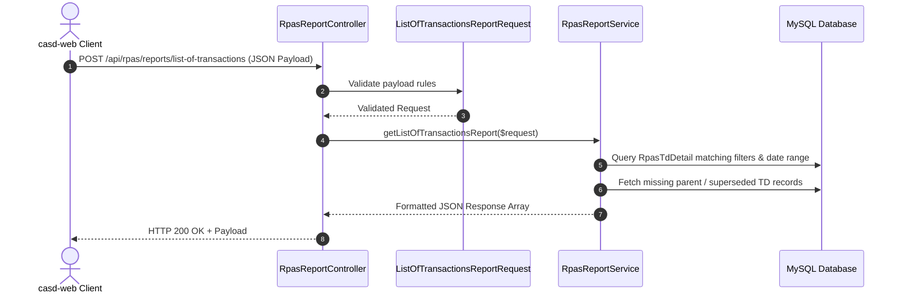

# RPAS List of Transactions API Endpoint Specification

This document details the architecture, request parameters, database query logic, status handling, parent fetching, and response payload transformation of the **`list-of-transactions`** API endpoint in the `casd-api` backend service.

---

## 1. Endpoint Overview

* **Route**: `POST /api/rpas/reports/list-of-transactions` (and authenticated route aliases)
* **Controller**: [`App\Http\Controllers\Rpas\RpasReport\RpasReportController@listOfTransactions`](file:///c:/Users/Administrator/Desktop/RPAS/Development/casd-api/app/Http/Controllers/Rpas/RpasReport/RpasReportController.php#L41-L46)
* **Request Handler**: [`App\Http\Requests\Rpas\RpasReport\ListOfTransactionsReportRequest`](file:///c:/Users/Administrator/Desktop/RPAS/Development/casd-api/app/Http/Requests/Rpas/RpasReport/ListOfTransactionsReportRequest.php)
* **Service Method**: [`App\Services\Rpas\RpasReportService\RpasReportService@getListOfTransactionsReport`](file:///c:/Users/Administrator/Desktop/RPAS/Development/casd-api/app/Services/Rpas/RpasReportService/RpasReportService.php#L807-L1129)



---

## 2. Request Parameters & Validation

The endpoint accepts parameters via JSON or Form Data. The table below lists all supported input fields:

| Field | Type | Required / Nullable | Description & Fallback Logic |
| :--- | :--- | :--- | :--- |
| `start_date` | `string` (`YYYY-MM-DD`) | Nullable | Start date for transaction filtering. If absent, defaults to 1st day of `month`/`year`. |
| `end_date` | `string` (`YYYY-MM-DD`) | Nullable | End date for transaction filtering. If absent, defaults to last day of `month`/`year`. |
| `month` | `integer` (1-12) | Nullable | Target month number (defaults to current month if `start_date`/`end_date` omitted). |
| `year` | `integer` (1900-2100) | Nullable | Target year (defaults to current year if `start_date`/`end_date` omitted). |
| `select_all_barangay` | `boolean` | Nullable | If `true`, returns records for all barangays. |
| `barangay_ids` / `barangays` | `array<integer>` | Nullable | Array of Barangay IDs to filter. |
| `barangay_id` | `integer` | Nullable | Single Barangay ID filter (used when `select_all_barangay` is `false`). |
| `rpas_smv_id` / `smv_id` | `integer` | Nullable | Schedule of Market Values ID. Defaults to latest approved SMV if omitted. |
| `is_approved` / `approved` | `boolean` | Nullable | Filters by **Approved** sub-status (`rpas_sub_status_id = 2`). (Default mode). |
| `is_validated` / `validated` | `boolean` | Nullable | Filters by **Validated** sub-status (`rpas_sub_status_id = 1`). |
| `taxability` | `string` | Nullable | Filter options: `'all'`, `'taxable'`, `'exempt'` / `'exempted'`. |
| `is_taxable` | `boolean` | Nullable | Explicit boolean for taxable properties filter. |
| `is_exempted` | `boolean` | Nullable | Explicit boolean for tax-exempt properties filter. |

---

## 3. Backend Processing Workflow & Business Logic

### Step 1: Date Range Normalization
If explicit `start_date` and `end_date` are not provided:
$$\text{Start Date} = \text{Carbon::createFromDate}(\text{year}, \text{month}, 1)\rightarrow\text{startOfDay()}$$
$$\text{End Date} = \text{Carbon::createFromDate}(\text{year}, \text{month}, 1)\rightarrow\text{endOfMonth()}\rightarrow\text{endOfDay()}$$

### Step 2: Barangay & Location Scope Resolution
* If `select_all_barangay` is `true` or no barangay IDs are specified:
  * `barangayName` = `'ALL BARANGAYS'`
  * `barangayCode` = `'ALL'`
  * `districtCode` = `'ALL'`
* If a single Barangay ID is provided/resolved:
  * Loads `RpasBarangay` with `rpasDistrict` relationship to resolve exact `name`, `code`, and `district_code`.

### Step 3: Status Mode Resolution (Approved vs. Validated)
* Default status mode is **`approved`** (`subStatusId = 2`, `code = 'is_approved'`).
* If `validated` or `is_validated` is explicitly `true` (and `is_approved` is `false`), status mode switches to **`validated`** (`subStatusId = 1`, `code = 'is_validated'`).

### Step 4: Base Query Construction & Relationship Eager-Loading
Query executes on `RpasTdDetail` with eager loading:
* `rpasBarangay.rpasDistrict`
* `rpasSmv`
* `kind` (`id`, `code`, `name`)
* `transaction` (`id`, `code`, `name`)
* `appraisals.appraisalClass`, `appraisals.actualUse`
* `subStatuses.rpasSubStatus`, `currentStatus.rpasStatus`
* `nocTaxDec`, `supersededTd`, `parents`

#### Filtering Conditions:
1. **Barangay Scope**: `whereIn('rpas_barangay_id', $barangayIds)`
2. **SMV Scope**: `where('rpas_smv_id', $smvId)`
3. **Taxability Filter**:
   * `'taxable'`: `whereHas('appraisals', fn($q) => $q->where('tax_exempted', false))`
   * `'exempt'` / `'exempted'`: `whereHas('appraisals', fn($q) => $q->where('tax_exempted', true))`
4. **Target Date & Status Match**: Record must satisfy **at least one** of:
   * Active sub-status matching target status (`is_approved` / `is_validated`) created within `[start_date, end_date]`.
   * **OR** Cancelled status (`rpas_status_id = 2` or code in `['cancelled', 'cancelled_by_noc']`) created/updated within `[start_date, end_date]`.
   * **OR** Linked to a Notice of Cancellation (`nocTaxDec`) created/updated within `[start_date, end_date]`.

---

### Step 5: Parent / Superseded TD Fetching
To enable front-end **ROA (Roll of Assessment) vs. RCA (Roll of Cancelled Assessment)** side-by-side comparison pairing:
* The service identifies all `superseded_td_id` and `parents` IDs referenced by the matched records.
* Any parent IDs not already present in the query result are fetched in a secondary query and merged into the primary `$records` collection.

---

### Step 6: Data Transformation & Universal Schema
Each record is mapped into a normalized JSON structure:

```json
{
  "td_detail_id": 1052,
  "kind": { "id": 1, "code": "L", "name": "LAND" },
  "smv": { "id": 5, "code": "20", "year": 2020 },
  "district_barangay": {
    "district": { "id": 1, "code": 1 },
    "barangay": { "id": 2, "code": 2, "name": "AMPAYON" }
  },
  "td_number": "20-01-0002-00015",
  "validated_date": "03/15/2026",
  "approved_date": "03/18/2026",
  "cancelled_date": null,
  "cancelled_by_notice_of_cancellation": false,
  "pin": {
    "pin_number": "162-01-0002-010-03",
    "section": 10,
    "parcel": 3
  },
  "transaction": { "id": 2, "code": "GR", "name": "GENERAL REVISION" },
  "area": 500.0,
  "total_market_value": 750000.0,
  "total_assessed_value": 150000.0,
  "appraisals": [
    {
      "id": 210,
      "area": 500.0,
      "tax_exempted": 0,
      "class": {
        "id": 1,
        "code": "R",
        "name": "RESIDENTIAL",
        "adjusted_market_value": 750000.0
      },
      "actual_use": {
        "id": 1,
        "code": "R",
        "name": "RESIDENTIAL",
        "level": 20.0,
        "assessed_value": 150000.0
      }
    }
  ],
  "previous_td": [1014]
}
```

---

## 4. Top-Level Response Wrapper

```json
{
  "barangay_name": "AMPAYON",
  "barangay_code": "0002",
  "district_code": "01",
  "taxability_label": "ALL",
  "month_name": "MARCH",
  "year": 2026,
  "smv_year": "2020",
  "status_mode": "approved",
  "start_date": "2026-03-01",
  "end_date": "2026-03-31",
  "transactions": [ /* Array of transformed TD objects */ ]
}
```
