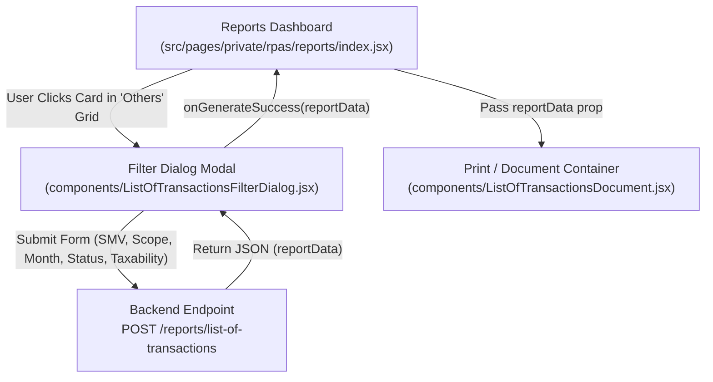
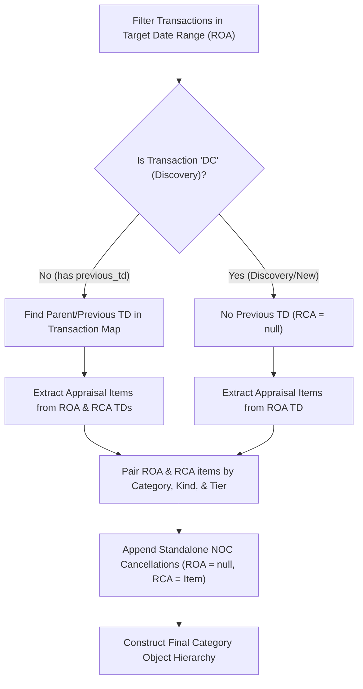

# RPAS List of Transactions Document Generation & Frontend Specification

This document details the frontend implementation, parameter filter modal, document generation algorithm, business rules, and API consumption for the **LIST OF TRANSACTIONS (ASSESSMENT AND CANCELLATION)** report in `casd-web`.

---

## 1. Component Architecture & Workflow

The feature is built with three main modular React components:



---

## 2. Parameter Filter Modal (`ListOfTransactionsFilterDialog.jsx`)

When the user selects the **LIST OF TRANSACTIONS (ASSESSMENT AND CANCELLATION)** card, a modal opens to configure parameters before fetching data.

### Filter Input Options
1. **SMV / General Revision Year**: Dropdown selecting from `smvs` (`rpas_smv_id`). Defaults to the current active/approved SMV.
2. **Barangay Scope**:
   * **All Barangays**: Sets `select_all_barangay: true`, `barangay_ids: []`.
   * **Individual Barangays**: Multi-select dropdown (`selectedBarangays`). Sets `select_all_barangay: false`, `barangay_ids: [...]`.
3. **Month & Year Picker**: Month (1-12) and Year fields. Automatically constructs:
   $$\text{start\_date} = \text{YYYY-MM-01}$$
   $$\text{end\_date} = \text{YYYY-MM-}[\text{Last Day of Month}]$$
4. **Status Mode**: Radio selection between **Approved** (`is_approved: true`) and **Validated** (`is_validated: true`).
5. **Taxability Filter**: Segmented control for `'all'`, `'taxable'`, or `'exempted'`.

### API Payload Construction & Submission
```javascript
const payload = {
  start_date: startDate,
  end_date: endDate,
  month: Number(selectedMonth),
  year: Number(selectedYear),
  select_all_barangay: !isIndividual,
  barangay_ids: isIndividual ? selectedBarangays.map((b) => b.id) : [],
  rpas_smv_id: selectedSmv ? selectedSmv.id : null,
  approved: statusMode === "approved",
  validated: statusMode === "validated",
  is_approved: statusMode === "approved",
  is_validated: statusMode === "validated",
  taxability: taxFilter,
  is_all: taxFilter === "all",
  is_taxable: taxFilter === "taxable",
  is_exempted: taxFilter === "exempted",
};

// API Call
const response = await handleRequest(() => API.post("reports/list-of-transactions", payload));
```

---

## 3. Document Data Processing Engine (`arrangeListOfTransactionsData`)

The `ListOfTransactionsDocument.jsx` component receives `reportData` and transforms raw transaction arrays into structured comparison pairs between **ROA (Roll of Assessment)** and **RCA (Roll of Cancelled Assessment)**.

### Step 1: Date Range Guard (`isDateInRange`)
Validates whether a record's validation/approval/cancellation date falls strictly within the requested `[start_date, end_date]` window.

### Step 2: Property Kind & Building Tier Resolution
* **Kind Types**: Maps kind code (`L` $\rightarrow$ `'land'`, `B` $\rightarrow$ `'building'`, `M` $\rightarrow$ `'machinery'`).
* **Building Tiering**: Buildings are split into two assessment value threshold sub-tables based on total market value:
  * **Over ₱175,000**: `building.roa.over_175k` / `building.rca.over_175k`
  * **₱175,000 & Below**: `building.roa.less_175k` / `building.rca.less_175k`

---

### Step 3: Classification vs. Actual Use Alignment & Cross-Classification Visual Tracer

In property assessment, a property's **Classification** (e.g. Commercial) may differ from its **Actual Use** (e.g. Residential). The data engine enforces the following business rules:

#### Rule A: Alignment Rules
* **Market Value (MV)** & **Area** are listed under the property's **Classification**.
* **Assessed Value (AV)** is listed under the property's **Actual Use**.

#### Rule B: Cross-Classification Visual Tracer (When Class $\neq$ Actual Use)
When `Classification` $\neq$ `Actual Use`, `extractItemsFromTd()` splits the appraisal record into **two paired entries**:

1. **Origin Entry (Placed in Classification Category)**:
   * Holds `market_value` and `area`.
   * `assessed_value` is set to **`null`** (rendered as blank).
   * `is_tracer` = `false`.

2. **Tracer Entry (Placed in Actual Use Category)**:
   * Holds `assessed_value`.
   * `market_value` and `area` are set to **`null`** (rendered as blank).
   * `is_tracer` = `true`, storing `tracer_origin_category = Classification`.

```
EXAMPLE TRACER (Classification = COMMERCIAL, Actual Use = RESIDENTIAL):

COMMERCIAL SECTION (ROA):
┌────────────────┬───────────────┬──────┬──────────────┬────────────────┐
│ TD NUMBER      │ PIN NUMBER    │ AREA │ MARKET VALUE │ ASSESSED VALUE │
├────────────────┼───────────────┼──────┼──────────────┼────────────────┤
│ 20-01-0002-005 │ 162-01...-005 │ 250m²│ ₱ 500,000.00 │                │  <-- Blank AV
└────────────────┴───────────────┴──────┴──────────────┴────────────────┘

RESIDENTIAL SECTION (ROA):
┌────────────────┬───────────────┬──────┬──────────────┬────────────────┐
│ TD NUMBER      │ PIN NUMBER    │ AREA │ MARKET VALUE │ ASSESSED VALUE │
├────────────────┼───────────────┼──────┼──────────────┼────────────────┤
│ 20-01-0002-005 │ 162-01...-005 │      │              │  ₱ 100,000.00  │  <-- Blank MV & Area
└────────────────┴───────────────┴──────┴──────────────┴────────────────┘
```

---

### Step 4: ROA - RCA Pairing Algorithm



1. **Step A**: Filter all transactions where target date (`approved_date` or `validated_date`) falls within date range $\rightarrow$ `roaTds`.
2. **Step B**: For each `roaTd`:
   * If transaction code is **`DC`** (Discovery/New Property), it has **no previous TD** ($\text{RCA} = \text{null}$).
   * Otherwise, lookup its `previous_td` ID from the transaction map to get the canceled parent record (`prevTd`).
   * Group and pair ROA items and RCA items by `Category | KindType | Tier`.
3. **Step C (Standalone Cancellations)**:
   * Filter transactions canceled via Notice of Cancellation (`cancelled_by_notice_of_cancellation = true` within date range).
   * Added to buckets with $\text{ROA} = \text{null}$ and $\text{RCA} = \text{cItem}$.

---

## 4. Document Layout & Rendering Structure

The rendered output is structured into distinct main categories:
1. **RESIDENTIAL**
2. **COMMERCIAL**
3. **INDUSTRIAL**
4. **AGRICULTURAL**
5. **TIMBERLAND**
6. **SPECIAL**

Each category contains side-by-side comparative sub-tables split into **ROLL OF ASSESSMENT (ROA)** on the left and **ROLL OF CANCELLED ASSESSMENT (RCA)** on the right:

```
┌───────────────────────────────────────────────────┬───────────────────────────────────────────────────┐
│              ROLL OF ASSESSMENT (ROA)             │         ROLL OF CANCELLED ASSESSMENT (RCA)        │
├───────┬─────┬──────┬──────────────┬───────────────┼───────┬─────┬──────┬──────────────┬───────────────┤
│ TD NO │ PIN │ AREA │ MARKET VALUE │ ASSESSED VALUE│ TD NO │ PIN │ AREA │ MARKET VALUE │ ASSESSED VALUE│
└───────┴─────┴──────┴──────────────┴───────────────┴───────┴─────┴──────┴──────────────┴───────────────┘
```

### Table Sections per Category:
* **Land**
* **Building (Market Value Over ₱175,000)**
* **Building (Market Value ₱175,000 and Below)**
* **Machinery**
* **Category Subtotals & Grand Totals**
