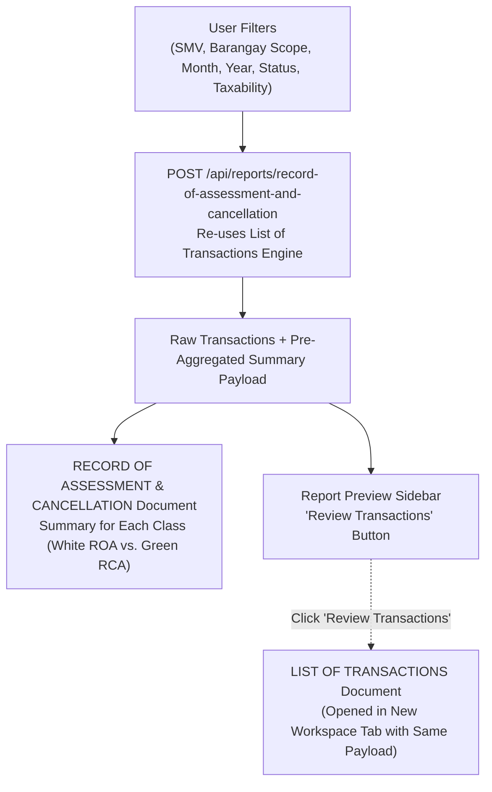

# RECORD OF ASSESSMENT (ROA) AND RECORD OF CANCELLATION (RCA) Specification

This document details the functional requirements, backend data structure, frontend visual design, classification table rules, and sidebar integration for the **RECORD OF ASSESSMENT (ROA) AND RECORD OF CANCELLATION (RCA) - SUMMARY FOR EACH CLASS** report.

---

## 1. Overview & Architecture

The **Record of Assessment (ROA) and Record of Cancellation (RCA)** report provides an executive, tabular summary of real property assessment roll movements for a specified jurisdiction and monthly billing period.

Unlike the detailed [List of Transactions](file:///c:/Users/Administrator/Desktop/RPAS/Development/docs/modules/reports/list_of_transactions/frontend_spec.md) report—which enumerates individual Tax Declarations, owners, lot pins, and transaction codes—this report aggregates additions (ROA) and cancellations (RCA) into concise, high-level summary rows grouped strictly by property classification.



---

## 2. Visual Layout & Document Format

Based on the official assessor template, the report is formatted in **Landscape** orientation:

```
               RECORD OF ASSESSMENT (ROA) AND RECORD OF CANCELLATION (RCA)
                                 SUMMARY FOR EACH CLASS
                                  Month of AUGUST, 2026

DISTRICT NO. : 7                                                BARANGAY: BONBON
========================================================================================================================================
SUMMARY FOR EACH CLASS   |                  LAND                  |            BUILDING          |           MACHINERY
                         | No. of RPU's | AREA (sq.m.) | MARKET VALUE | ASSESSED VALUE | No. of RPU's | MARKET VALUE | ASSESSED VALUE | No. of RPU's | MARKET VALUE | ASSESSED VALUE
----------------------------------------------------------------------------------------------------------------------------------------
RESIDENTIAL (white)      |     11       |   13,053     |  22,149,410  |    901,840     |      3       |  4,186,390   |   1,432,790    |      -       |      -       |       -
RESIDENTIAL (green)      |      4       |   13,513     |  23,163,620  |    942,430     |      2       |  1,079,670   |     252,240    |      -       |      -       |       -
(white - less 175k)      |              |              |              |                |      1       |     27,940   |           -    |              |              |
(green - less 175k)      |              |              |              |                |      1       |     27,940   |           -    |              |              |
----------------------------------------------------------------------------------------------------------------------------------------
AGRICULTURAL (white)     |     10       |   10,300     |      69,640  |     13,210     |      -       |           -  |           -    |      -       |      -       |       -
AGRICULTURAL (green)     |      2       |      300     |       3,330  |        630     |      -       |           -  |           -    |      -       |      -       |       -
----------------------------------------------------------------------------------------------------------------------------------------
COMMERCIAL (white)       |      1       |      175     |     397,250  |          -     |      -       |           -  |           -    |      -       |      -       |       -
COMMERCIAL (green)       |      1       |      175     |     397,250  |          -     |      -       |           -  |           -    |      -       |      -       |       -
----------------------------------------------------------------------------------------------------------------------------------------
INDUSTRIAL (white)       |      -       |        -     |           -  |          -     |      -       |           -  |           -    |      -       |      -       |       -
INDUSTRIAL (green)       |      -       |        -     |           -  |          -     |      -       |           -  |           -    |      -       |      -       |       -
----------------------------------------------------------------------------------------------------------------------------------------
TIMBERLAND (white)       |      -       |        -     |           -  |          -     |      -       |           -  |           -    |      -       |      -       |       -
TIMBERLAND (green)       |      -       |        -     |           -  |          -     |      -       |           -  |           -    |      -       |      -       |       -
----------------------------------------------------------------------------------------------------------------------------------------
TOTAL (white - ROA)      |     22       |   23,528     |  22,616,300  |    915,050     |      4       |  4,214,330   |   1,432,790    |      -       |      -       |       -
TOTAL (green - RCA)      |      7       |   13,988     |  23,564,200  |    943,060     |      3       |  1,107,610   |     252,240    |      -       |      -       |       -
```

### 2.1 Header Section
1. **Title**: `RECORD OF ASSESSMENT (ROA) AND RECORD OF CANCELLATION (RCA)` (bold, uppercase, centered).
2. **Subtitle**: `SUMMARY FOR EACH CLASS` (bold, uppercase, centered).
3. **Period Line**: `Month of [MONTH], [YEAR]` (e.g. `Month of AUGUST, 2026`).
4. **Jurisdiction Line**:
   - Left: `DISTRICT NO. : [DISTRICT_CODE]` (with underline).
   - Right: `BARANGAY: [BARANGAY_NAME]` (bold, uppercase).

---

## 3. Classification Table Structure & Business Rules

### 3.1 Column Definitions (11 Columns)
* **Column 1**: `SUMMARY FOR EACH CLASS` (Category header, row-spanned across the class's sub-rows).
* **Columns 2–5 (LAND)**:
  * `No. of RPU's`: Count of unique Land Real Property Units.
  * `AREA (sq.m.)`: Total declared land area in square meters.
  * `MARKET VALUE`: Total market value for Land.
  * `ASSESSED VALUE`: Total assessed value for Land.
* **Columns 6–8 (BUILDING)**:
  * `No. of RPU's`: Count of unique Building Real Property Units.
  * `MARKET VALUE`: Total market value for Building.
  * `ASSESSED VALUE`: Total assessed value for Building.
  * *(Note: Buildings do not have an Area column)*.
* **Columns 9–11 (MACHINERY)**:
  * `No. of RPU's`: Count of unique Machinery Real Property Units.
  * `MARKET VALUE`: Total market value for Machinery.
  * `ASSESSED VALUE`: Total assessed value for Machinery.
  * *(Note: Machineries do not have an Area column)*.

### 3.2 Row Pairing & Color Coding (ROA vs. RCA)
Every property category alternates between additions (ROA) and cancellations (RCA):
* **White / Colorless Cells (`#ffffff`)**:
  * Represents **Roll of Assessment (ROA)** additions (newly validated/approved TDs).
* **Green Cells (`#92d050`)**:
  * Represents **Roll of Cancelled Assessment (RCA)** deductions (superseded or cancelled TDs).
  * **All cells across every RCA row** (including Land, Building, Machinery, and the `TOTAL (RCA)` summary row) are rendered with the green background (`#92d050`).

### 3.3 The Residential Building Tiering Exception (4 Rows)
Under BLGF guidelines, residential buildings are stratified into two assessment brackets:
1. **Over ₱175,000 (`over_175k`)**:
   - Assessed at standard progressive assessment levels.
2. **₱175,000 & Below (`less_175k`)**:
   - Special assessment tier (assessed at 0% or base statutory bracket).

Because of this dual tiering:
* **`RESIDENTIAL`** spans **4 rows**:
  * **Row 1 (White - ROA)**: Land ROA, Building **Over ₱175k** ROA, Machinery ROA (`is_rca: false`).
  * **Row 2 (Green - RCA)**: Land RCA, Building **Over ₱175k** RCA, Machinery RCA (`is_rca: true`).
  * **Row 3 (White - ROA)**: Building **₱175,000 & Below** ROA (`is_rca: false`, Land & Machinery cells are blank).
  * **Row 4 (Green - RCA)**: Building **₱175,000 & Below** RCA (`is_rca: true`, Land & Machinery cells are blank).
* **All Other Categories (`AGRICULTURAL`, `COMMERCIAL`, `INDUSTRIAL`, `TIMBERLAND`, `SPECIAL`)**:
  * Span **2 rows**:
    * **Row 1 (White - ROA)**: Land ROA, Combined Building ROA (`[...over_175k, ...less_175k]`), Machinery ROA (`is_rca: false`).
    * **Row 2 (Green - RCA)**: Land RCA, Combined Building RCA, Machinery RCA (`is_rca: true`).

### 3.4 Calculation & Exclusion Rules (Engine Alignment with List of Transactions)
The report calculations strictly reuse the data engine (`arrangeListOfTransactionsData`) and counting logic (`getRpuCount`) from the [List of Transactions](file:///c:/Users/Administrator/Desktop/RPAS/Development/docs/modules/reports/list_of_transactions/frontend_spec.md) report to guarantee 100% mathematical consistency across reports:

1. **RPU Count (`No. of RPU's`)**:
   - Computed via `getRpuCount(list)`.
   - **Excludes Tracers**: Filtered with `!item.is_tracer` so cross-classification tracers never increment the RPU count.
   - **Spans Identical TDs**: Groups consecutive entries with the same `td_number`, ensuring multi-appraisal TDs are counted as exactly 1 physical RPU.

2. **Land Area (`AREA (sq.m.)`)**:
   - Sums declared land area only for non-tracer items (`!item.is_tracer`).
   - Buildings and machinery do not have area columns.

3. **Market Value (`MARKET VALUE`)**:
   - Sums all items in the bucket. Tracers have `market_value: null` (evaluated as 0), so market value is attributed strictly to the origin Classification.

4. **Assessed Value (`ASSESSED VALUE`)**:
   - Sums all items in the bucket. Origin items where `class !== actual_use` have `assessed_value: null` (evaluated as 0), while tracer items carry the assessed value under the Actual Use.

5. **Exclusion & Neglect Rules for Special Transactions**:
   - **Standalone Notice of Cancellation (NOC)**: Transactions cancelled via Notice of Cancellation (`cancelled_by_notice_of_cancellation = true` within date range) without a superseding TD are assigned `roa = null` and `rca = item`. They are **completely neglected in ROA** (contribute 0 to ROA RPU, Area, MV, and AV) and **counted only in RCA**.
   - **Discovery / New Property (`DC`)**: Transactions with code `DC` have no previous TD and are assigned `roa = item` and `rca = null`. They are **counted in ROA** and **completely neglected in RCA**.
   - **Cross-Classification Tracers (`Classification !== Actual Use`)**:
     - *Origin Item (Classification)*: `area = area`, `market_value = mv`, `assessed_value = null`, `no_of_rpu = 1`, `is_tracer = false`.
     - *Tracer Item (Actual Use)*: `area = null`, `market_value = null`, `assessed_value = av`, `no_of_rpu = null`, `is_tracer = true`.
     - Ensures the physical RPU and market value are registered under Classification, while assessed value is registered under Actual Use, preventing duplicate RPU counts.


---

## 4. Backend Endpoint Specification

### 4.1 Endpoint Contract
* **Route**: `POST /api/reports/record-of-assessment-and-cancellation` (and `POST /api/rpas/reports/record-of-assessment-and-cancellation`)
* **Controller**: `App\Http\Controllers\Rpas\RpasReport\RpasReportController@recordOfAssessmentAndCancellation`
* **Request Validator**: `App\Http\Requests\Rpas\RpasReport\RecordOfAssessmentAndCancellationReportRequest`
* **Service Method**: `App\Services\Rpas\RpasReportService\RpasReportService@getRecordOfAssessmentAndCancellationReport`

### 4.2 Request Payload
Accepts identical parameters as the [List of Transactions Report Request](file:///c:/Users/Administrator/Desktop/RPAS/Development/docs/modules/reports/list_of_transactions/api_spec.md#2-request-parameters--validation):

```json
{
  "start_date": "2026-08-01",
  "end_date": "2026-08-31",
  "month": 8,
  "year": 2026,
  "rpas_smv_id": 1,
  "select_all_barangay": false,
  "barangay_ids": [3],
  "is_approved": true,
  "is_validated": false,
  "status": "approved",
  "taxability": "all"
}
```

### 4.3 Response Payload
The endpoint returns the pre-aggregated summary structure for immediate document rendering, alongside the full `transactions` array for side-by-side transaction inspection:

```json
{
  "city": "Butuan",
  "district_code": "07",
  "district_no": 7,
  "barangay_name": "BONBON",
  "barangay_code": "0003",
  "month_name": "AUGUST",
  "year": 2026,
  "smv_year": "2020",
  "status_mode": "approved",
  "taxability_label": "ALL",
  "start_date": "2026-08-01",
  "end_date": "2026-08-31",
  "summary": [
    {
      "category": "RESIDENTIAL",
      "has_split_building": true,
      "rows": [
        {
          "type": "ROA",
          "tier": "over_175k",
          "is_rca": false,
          "land": { "rpu_count": 11, "area": 13053.0, "market_value": 22149410.0, "assessed_value": 901840.0 },
          "building": { "rpu_count": 3, "market_value": 4186390.0, "assessed_value": 1432790.0 },
          "machinery": { "rpu_count": 0, "market_value": 0, "assessed_value": 0 }
        },
        {
          "type": "RCA",
          "tier": "over_175k",
          "is_rca": true,
          "land": { "rpu_count": 4, "area": 13513.0, "market_value": 23163620.0, "assessed_value": 942430.0 },
          "building": { "rpu_count": 2, "market_value": 1079670.0, "assessed_value": 252240.0 },
          "machinery": { "rpu_count": 0, "market_value": 0, "assessed_value": 0 }
        },
        {
          "type": "ROA",
          "tier": "less_175k",
          "is_rca": false,
          "land": null,
          "building": { "rpu_count": 1, "market_value": 27940.0, "assessed_value": 0 },
          "machinery": null
        },
        {
          "type": "RCA",
          "tier": "less_175k",
          "is_rca": true,
          "land": null,
          "building": { "rpu_count": 1, "market_value": 27940.0, "assessed_value": 0 },
          "machinery": null
        }
      ]
    },
    {
      "category": "AGRICULTURAL",
      "has_split_building": false,
      "rows": [
        {
          "type": "ROA",
          "is_rca": false,
          "land": { "rpu_count": 10, "area": 10300.0, "market_value": 69640.0, "assessed_value": 13210.0 },
          "building": { "rpu_count": 0, "market_value": 0, "assessed_value": 0 },
          "machinery": { "rpu_count": 0, "market_value": 0, "assessed_value": 0 }
        },
        {
          "type": "RCA",
          "is_rca": true,
          "land": { "rpu_count": 2, "area": 300.0, "market_value": 3330.0, "assessed_value": 630.0 },
          "building": { "rpu_count": 0, "market_value": 0, "assessed_value": 0 },
          "machinery": { "rpu_count": 0, "market_value": 0, "assessed_value": 0 }
        }
      ]
    }
  ],
  "transactions": [ /* Full list of individual TD objects */ ]
}
```

---

## 5. Frontend Document & Sidebar Integration

### 5.1 Card Renaming
In `casd-web/src/pages/private/rpas/reports/index.jsx`, the card title is updated:
* Old Title: `Record of Assessments`
* New Title: **`RECORD OF ASSESSMENT (ROA) AND RECORD OF CANCELLATION (RCA)`**
* Identifier Flag: `isRecordOfAssessmentAndCancellation: true`

### 5.2 Filter Dialog
Uses `RecordOfAssessmentAndCancellationFilterDialog.jsx` sharing the exact parameter controls as List of Transactions:
* Schedule of Market Values (SMV)
* Barangay Scope (All Barangays vs Individual)
* Month & Year pickers
* Status Mode (`Approved` vs `Validated` per [rpas_td_statuses.md](file:///c:/Users/Administrator/Desktop/RPAS/Development/docs/architecture/rpas_td_statuses.md))
* Taxability (`All`, `Taxable`, `Exempted`)

### 5.3 Sidebar Integration: "Review Transactions" Action
In `ReportPreviewSidebar.jsx`:
* When displaying a Record of Assessment and Cancellation document, a dedicated action button is rendered at the top of the sidebar:
  **`[ Review Transactions (List of Transactions) ]`**
* Clicking this button invokes `openNewFaas(...)` to open the full `ListOfTransactionsDocument` in a new workspace tab, passing the identical `reportData` payload.
* This allows assessors to instantly audit the individual TDs making up any cell's aggregate totals.

### 5.4 Multi-Barangay Table Separation
When **more than one barangay is selected** for report generation (e.g., specific selection of Agao and Ampayon, or All Barangays spanning multiple barangays):
* The document dynamically generates **separate sets of tables for each barangay**.
* Each barangay displays its own:
  - Header (`RECORD OF ASSESSMENT (ROA) AND RECORD OF CANCELLATION (RCA) - SUMMARY FOR EACH CLASS - Month of [MONTH], [YEAR]`)
  - Jurisdiction Line (`DISTRICT NO. : [DISTRICT]` and `BARANGAY: [BARANGAY_NAME]`)
  - Full summary classification table (Residential Over/Less 175k, Agricultural, Commercial, Industrial, Timberland, Special)
  - Grand Totals (TOTAL ROA in white, TOTAL RCA in green).
* Scoped calculation is powered by `buildRoaRcaSummaryData(reportData, filterBarangay)`, which scopes ROA and NOC records per barangay while maintaining global parent TD lookup for RCA values.
* Separate barangay sheets are demarcated on screen with dashed borders and margin spacing, and formatted for printing with `@media print { pageBreakAfter: "always", breakAfter: "page" }`.

---

## Related Documentation
* [List of Transactions API Specification](file:///c:/Users/Administrator/Desktop/RPAS/Development/docs/modules/reports/list_of_transactions/api_spec.md)
* [List of Transactions Frontend Specification](file:///c:/Users/Administrator/Desktop/RPAS/Development/docs/modules/reports/list_of_transactions/frontend_spec.md)
* [RPAS TD Status & Sub-Status Architecture](file:///c:/Users/Administrator/Desktop/RPAS/Development/docs/architecture/rpas_td_statuses.md)
