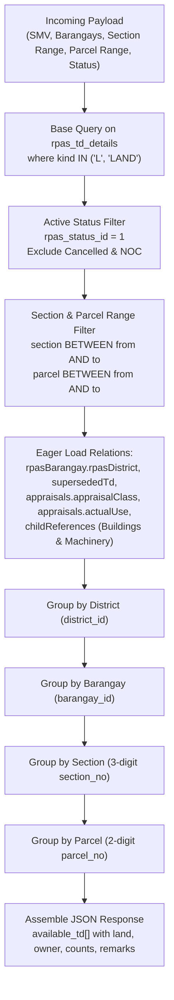

# RPAS Tax Map Control Roll (TMCR) API & Backend Specification

This document details the backend implementation, endpoint contracts, active-only filtering rules, relationship eager-loading, and nested data grouping for the **TAX MAP CONTROL ROLL** report in `casd-api`.

---

## 1. Overview & Architecture

The Tax Map Control Roll generates a comprehensive registry of all active land parcels organized by administrative and cartographic hierarchy:

$$\mathbf{District} \longrightarrow \mathbf{Barangay} \longrightarrow \mathbf{Section\ (3\ digits)} \longrightarrow \mathbf{Parcel\ (2\ digits)} \longrightarrow \mathbf{Available\ TD(s)}$$

### Key Objectives:
1. **Active TDs Only**: Filter **strictly active** Tax Declarations according to the primary lifecycle status and sub-status rules defined in [`rpas_td_statuses.md`](file:///c:/Users/Administrator/Desktop/RPAS/Development/docs/architecture/rpas_td_statuses.md). Exclude predecessor TDs cancelled by transactions (Transfer, Segregation, Consolidation) and exclude TDs cancelled by Notice of Cancellation (NOC) as defined in [`rpas_transaction_processes.md`](file:///c:/Users/Administrator/Desktop/RPAS/Development/docs/architecture/rpas_transaction_processes.md#6-system-wide-detection-rule-cancelled-by-transaction-vs-notice-of-cancellation).
2. **PIN Duplication Resilience**: Group TDs into an array (`available_td[]`) per parcel to gracefully support legacy data where multiple active TDs may reference the same parcel.
3. **Appraisal Order Alignment**: Pair land classification names and actual use values in matching 1-to-1 index order based on their underlying appraisal records.
4. **Improvement Counts**: Calculate the exact number of active **Building** and **Machinery** TDs physically hosted on each land parcel (matching district, barangay, section, and parcel).
5. **Sparse Grouping**: Omit empty sections and parcels where no matching data exists in the database (e.g., skip from section `001` directly to `024`).

---

## 2. API Endpoint & Request Payload

### Endpoint
* **Route**: `POST /api/reports/tax-map-control-roll` (or `/api/rpas/reports/tax-map-control-roll`)
* **Controller**: `App\Http\Controllers\Rpas\RpasReport\RpasReportController@taxMapControlRoll`
* **Service**: `App\Services\Rpas\RpasReportService\RpasReportService@getTaxMapControlRollReport`
* **Request Validator**: `App\Http\Requests\Rpas\RpasReport\TaxMapControlRollReportRequest`

### Request Payload (`POST`)

```json
{
  "rpas_smv_id": 1,
  "select_all_barangay": false,
  "barangay_ids": [1, 2],
  "section_from": "001",
  "section_to": "024",
  "parcel_from": "01",
  "parcel_to": "99",
  "status": "approved",
  "is_approved": true,
  "is_validated": false
}
```

### Parameter Validation Rules

| Field | Type | Required | Description / Validation |
| :--- | :---: | :---: | :--- |
| `rpas_smv_id` | `integer` | Optional | Foreign key to `rpas_smvs.id`. If omitted, defaults to latest approved SMV. |
| `select_all_barangay` | `boolean` | Required | If `true`, queries across all barangays within the city. |
| `barangay_ids` | `array<int>` | Cond. | Array of `rpas_barangays.id`. Required if `select_all_barangay` is `false`. |
| `section_from` | `string` / `int` | Optional | Starting section filter (e.g. `'001'`). Defaults to `1`. |
| `section_to` | `string` / `int` | Optional | Ending section filter (e.g. `'999'`). Defaults to `999`. |
| `parcel_from` | `string` / `int` | Optional | Starting parcel filter (e.g. `'01'`). Defaults to `1`. |
| `parcel_to` | `string` / `int` | Optional | Ending parcel filter (e.g. `'99'`). Defaults to `99`. |
| `status` / `is_approved` | `string` / `bool` | Optional | Defaults to approved (`subStatusId = 2`, `code = 'is_approved'`). Governed by [`rpas_td_statuses.md`](file:///c:/Users/Administrator/Desktop/RPAS/Development/docs/architecture/rpas_td_statuses.md#51-mode-resolution-rule). |
| `is_validated` | `boolean` | Optional | If `true`, filters records with validated sub-status (`subStatusId = 1`). Governed by [`rpas_td_statuses.md`](file:///c:/Users/Administrator/Desktop/RPAS/Development/docs/architecture/rpas_td_statuses.md#51-mode-resolution-rule). |

---

## 3. Database Query & Filtering Pipeline



### 3.1 Strict Active Status & Sub-Status Rules
Status and workflow filtering strictly adheres to the two-tier status architecture documented in [`rpas_td_statuses.md`](file:///c:/Users/Administrator/Desktop/RPAS/Development/docs/architecture/rpas_td_statuses.md) and cancellation lifecycle rules in [`rpas_transaction_processes.md`](file:///c:/Users/Administrator/Desktop/RPAS/Development/docs/architecture/rpas_transaction_processes.md#6-system-wide-detection-rule-cancelled-by-transaction-vs-notice-of-cancellation):

> [!NOTE]
> `rpas_status_id` and `cancelled_date` reside in `rpas_tax_declaration_statuses`, accessed via the `currentStatus` Eloquent relation on `RpasTdDetail`. They must never be queried as direct columns of `rpas_td_details`.

1. **Primary Lifecycle Status (`currentStatus`)**:
   - Must not have a cancelled status row in `rpas_tax_declaration_statuses`:
     ```php
     ->whereDoesntHave('currentStatus', function ($sq) {
         $sq->where('rpas_status_id', 2)
            ->orWhereHas('rpasStatus', fn($s) => $s->whereIn('code', ['cancelled', 'CANCELLED', 'cancelled_by_noc']))
            ->orWhereNotNull('cancelled_date')
            ->orWhereNotNull('rpas_noc_reason_id');
     })
     ```
2. **Exclude Notice of Cancellation Records**:
   - Must not be linked to any Notice of Cancellation record:
     ```php
     ->whereDoesntHave('nocTaxDec')
     ```
3. **Workflow Sub-Status Mode Filter (`rpas_sub_status` / `rpas_td_sub_statuses`)**:
   - As defined in [`rpas_td_statuses.md`](file:///c:/Users/Administrator/Desktop/RPAS/Development/docs/architecture/rpas_td_statuses.md#51-mode-resolution-rule), status mode is resolved as:
     - **Approved Mode** (default): Matches active sub-status `is_approved` (`subStatusId = 2`, `code = 'is_approved'`).
     - **Validated Mode** (`is_validated = true` or `status = 'validated'`): Matches active sub-status `is_validated` (`subStatusId = 1`, `code = 'is_validated'`).
   - Query filters records where `rpas_td_sub_statuses.is_active = true` for the resolved sub-status ID/code:
     ```php
     ->whereHas('subStatuses', function ($sub) use ($subStatusId, $subStatusCode) {
         $sub->where('is_active', true)
             ->where(function ($sq) use ($subStatusId, $subStatusCode) {
                 $sq->where('rpas_sub_status_id', $subStatusId)
                    ->orWhereHas('rpasSubStatus', fn($s) => $s->where('code', $subStatusCode));
             });
     })
     ```

### 3.2 Host Land vs. Improvement Counting
Buildings and Machinery reference their host Land via Section and Parcel digits (or `childReferences` in `rpas_relationships`).
For every host Land TD:
* **Building Count (`building_count`)**:
  Count of active TDs where `kind.code IN ('B', 'BLDG', 'BUILDING')` matching the same Barangay, Section, and Parcel.
* **Machinery Count (`machinery_count`)**:
  Count of active TDs where `kind.code IN ('M', 'MACH', 'MACHINERY')` matching the same Barangay, Section, and Parcel.

### 3.3 Previous TD & Remarks Resolution
* **Previous Tax Dec (`previous_tax_dec`)**:
  Derived from `superseded_td_id` $\rightarrow$ `rpas_td_details.td_number`. If none, returns `null`.
* **Remarks (`remarks`)**:
  Stores the **PIN of the predecessor TD** (e.g., `'162-01-0002-002-04'`), allowing assessors to trace parcel lineage across previous revisions or transfers.

---

## 4. Universal Response JSON Schema

```json
{
  "city": "Butuan",
  "index_no": 162,
  "data": [
    {
      "district_id": 1,
      "district_code": 1,
      "barangays": [
        {
          "id": 1,
          "name": "Agao",
          "code": 1,
          "sections": [
            {
              "section_no": "001",
              "parcel": [
                {
                  "parcel_no": "01",
                  "available_td": [
                    {
                      "id": 1052,
                      "td_number": "20-01-0001-00009",
                      "lot_number": "123",
                      "land": {
                        "title_no": "1233",
                        "area": 123.00,
                        "classifications": ["Commercial", "Residential"]
                      },
                      "owner": "Juan Dela Cruz",
                      "previous_tax_dec": "20-01-0001-00008",
                      "current_tax_dec": "20-01-0001-00009",
                      "actual_use": ["Commercial", "Commercial"],
                      "building_count": 3,
                      "machinery_count": 2,
                      "remarks": "162-01-0002-002-04"
                    }
                  ]
                },
                {
                  "parcel_no": "02",
                  "available_td": [
                    {
                      "id": 1053,
                      "td_number": "20-01-0001-00030",
                      "lot_number": "124",
                      "land": {
                        "title_no": "T-4567",
                        "area": 250.00,
                        "classifications": ["Residential"]
                      },
                      "owner": "Maria Santos",
                      "previous_tax_dec": null,
                      "current_tax_dec": "20-01-0001-00030",
                      "actual_use": ["Residential"],
                      "building_count": 0,
                      "machinery_count": 0,
                      "remarks": null
                    }
                  ]
                }
              ]
            },
            {
              "section_no": "024",
              "parcel": [
                {
                  "parcel_no": "01",
                  "available_td": [
                    {
                      "id": 1098,
                      "td_number": "20-01-0001-00088",
                      "lot_number": "550",
                      "land": {
                        "title_no": "T-8921",
                        "area": 420.50,
                        "classifications": ["Commercial"]
                      },
                      "owner": "Apex Holdings Inc.",
                      "previous_tax_dec": "20-01-0001-00045",
                      "current_tax_dec": "20-01-0001-00088",
                      "actual_use": ["Commercial"],
                      "building_count": 1,
                      "machinery_count": 0,
                      "remarks": "162-01-0001-024-01"
                    }
                  ]
                }
              ]
            }
          ]
        }
      ]
    }
  ]
}
```

---

## 5. Field Reference Dictionary

| Field Path | Source DB Table & Column | Formatting / Type | Description |
| :--- | :--- | :---: | :--- |
| `city` | Static Constant | `string` | Fixed City name: `"Butuan"`. |
| `index_no` | Static Constant | `integer` | Fixed City index code: `162`. |
| `district_id` | `rpas_districts.id` | `integer` | District primary key ID. |
| `district_code` | `rpas_districts.code` | `integer` | District code number (e.g., `1`, `2`). |
| `barangays[].id` | `rpas_barangays.id` | `integer` | Barangay primary key ID. |
| `barangays[].name` | `rpas_barangays.name` | `string` | Barangay Name (e.g., `"Agao"`). |
| `barangays[].code` | `rpas_barangays.code` | `integer` | Barangay code number (e.g., `1`, `2`, `12`). |
| `sections[].section_no` | `rpas_td_details.section` | `string (3 digits)` | Section code padded to 3 digits (e.g., `"001"`, `"024"`). |
| `parcel[].parcel_no` | `rpas_td_details.parcel` | `string (2 digits)` | Parcel code padded to 2 digits (e.g., `"01"`, `"99"`). |
| `available_td[].id` | `rpas_td_details.id` | `integer` | Tax Declaration primary key ID. |
| `available_td[].td_number` | `rpas_td_details.td_number` | `string` | Complete TD Number (e.g., `"20-01-0001-00009"`). |
| `available_td[].lot_number` | `rpas_td_details.lot_number` | `string` | Lot Number / Cadastral Lot identifier. |
| `land.title_no` | `rpas_td_details.oct_tct_cloa_number` | `string` | Certificate of title number (OCT/TCT/CLOA). |
| `land.area` | `rpas_td_details.area` or `total_land_area` | `float` | Declared Land Area in square meters. |
| `land.classifications` | `rpas_appraisals` $\rightarrow$ `appraisalClass.name` | `array<string>` | Ordered list of appraisal classification names. |
| `owner` | `rpas_td_details.owner_appear_on_td` | `string` | Primary registered property owner name. |
| `previous_tax_dec` | `supersededTd.td_number` | `string` / `null` | Predecessor TD Number replaced by this record. |
| `current_tax_dec` | `rpas_td_details.td_number` | `string` | Current active TD Number. |
| `actual_use` | `rpas_appraisals` $\rightarrow$ `actualUse.name` | `array<string>` | Ordered list of actual uses matching classification index. |
| `building_count` | Count of active building child TDs | `integer` | Count of active improvements classified as Building on this parcel. |
| `machinery_count` | Count of active machinery child TDs | `integer` | Count of active improvements classified as Machinery on this parcel. |
| `remarks` | `supersededTd.pin` | `string` / `null` | Previous PIN from superseded record. |
