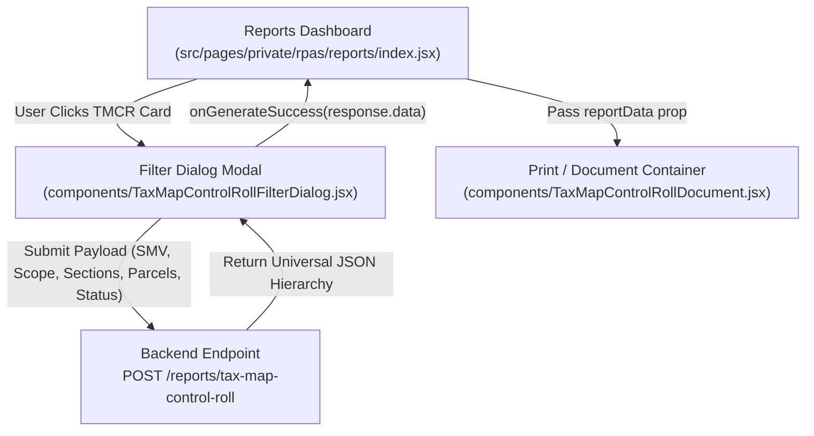

# RPAS Tax Map Control Roll (TMCR) Frontend Specification

This document details the React component architecture, filter modal parameter binding, universal response data transformation, document layout rules, and printing specifications for the **TAX MAP CONTROL ROLL** in `casd-web`.

---

## 1. Component Architecture & Workflow



---

## 2. Parameter Filter Modal (`TaxMapControlRollFilterDialog.jsx`)

### 2.1 Filter Controls

| Filter Control | UI Component | Description & Default Value |
| :--- | :--- | :--- |
| **SMV Year** | Dropdown (`Select`) | Schedule of Market Values general revision year (`rpas_smv_id`). Defaults to the active approved revision. |
| **Barangay Scope** | Radio Group | `'all'` (All Barangays) vs. `'individual'` (Selected Barangays). |
| **Barangay Selector** | Multiselect `Autocomplete` | Enabled only when Scope = `'individual'`. Allows selecting one or multiple barangays (`barangay_ids`). |
| **Section Range** | Text Fields (`From` & `To`) | 3-digit text inputs (default: `001` to `999` or `001` to `009`). |
| **Parcel Range** | Text Fields (`From` & `To`) | 2-digit text inputs (default: `01` to `99`). |
| **Status Mode** | Radio Group | `'approved'` (default, `is_approved = true`) or `'validated'` (`is_validated = true`). |

---

## 3. Document Header Layout Specification

The header layout strictly conforms to official assessment standards as demonstrated in the visual templates:

```
┌────────────────────────────────────────────────────────────────────────────────────────┐
│                                TAX MAP CONTROL ROLL                                    │
│                                                                                        │
│                               ┌──────────────────────┬────────────┐                    │
│                               │        BUTUAN        │    162     │                    │
│                               │  CITY / MUNICIPALITY │ INDEX NO.  │                    │
│                               ├──────────────────────┼────────────┤                    │
│                               │       [BARANGAY]     │ [DISTRICT] │                    │
│                               │       DISTRICT       │ INDEX NO.  │                    │
│                               └──────────────────────┴────────────┘                    │
│ ┌──────────────┬──────────────┐                                                        │
│ │    [0001]    │    [001]     │                                               Page  1  │
│ │BRGY.INDEX NO.│SEC. INDEX NO.│                                                        │
│ └──────────────┴──────────────┘                                                        │
└────────────────────────────────────────────────────────────────────────────────────────┘
```

### 3.1 Critical Header Mapping Rules

#### A. Center 2x2 Header Box
* **Row 1 Left**: `BUTUAN` (Label: `CITY / MUNICIPALITY`).
* **Row 1 Right**: `162` (Label: `INDEX NO.`).
* **Row 2 Left**: Displays the **NAME OF THE BARANGAY** (e.g. `AGAO`, `AMPAYON`, `LANGIHAN`), while its label below is **`DISTRICT`**.
* **Row 2 Right**: Displays the **DISTRICT CODE in 2-digit form** (e.g. `01`, `02`), while its label below is **`INDEX NO.`**.

#### Reference Examples from Official Roll:
1. **Agao (District 1, Barangay 1)**:
   - District Box Text: **`AGAO`**
   - Index No. Beside It: **`01`** (District 1 formatted as 2 digits)
2. **Ampayon (District 1, Barangay 2)**:
   - District Box Text: **`AMPAYON`**
   - Index No. Beside It: **`01`** (District 1 formatted as 2 digits)
3. **Langihan (District 2, Barangay 12)**:
   - District Box Text: **`LANGIHAN`**
   - Index No. Beside It: **`02`** (District 2 formatted as 2 digits)

---

#### B. Top Left Index Box
* **`BRGY. INDEX NO.`**: Sourced from `barangays[].code`, displayed strictly in **4-digit form**:
  - Code `1` $\rightarrow$ `0001` (Agao)
  - Code `2` $\rightarrow$ `0002` (Ampayon)
  - Code `12` $\rightarrow$ `0012` (Langihan)
* **`SEC. INDEX NO.`**: Sourced from `sections[].section_no`, displayed strictly in **3-digit form** (e.g., `001`, `024`, `192`, `233`).

---

## 4. Main Table Columns & Data Formatting

```
┌───────┬───────────────────┬──────────┬───────────┬─────────────┬───────────────┬────────────┬────────────┬────────┬──────────────┬─────────┐
│  LOT  │ CAD. / LOT / BLK. │  TITLE   │   LAND    │ CLASSIFI-   │ NAME OF OWNER │  PREVIOUS  │  CURRENT   │ ACTUAL │  NUMBER OF   │ REMARKS │
│  PIN  │ / SURVEY NO.      │   NO.    │   AREA    │ CATION      │               │  TAX DEC   │  TAX DEC   │  USE   │Bldg|Mach|Oth │         │
├───────┼───────────────────┼──────────┼───────────┼─────────────┼───────────────┼────────────┼────────────┼────────┼────┼────┼───┼─────────┤
│  001  │ Lot 123           │ 1233     │ 123.00    │ Commercial  │ Juan Dela Cruz│20-01-...08 │20-01-...09 │ Comm.  │ 3  │ 2  │ - │162-01.. │
│       │                   │          │           │ Residential │               │            │            │ Comm.  │    │    │   │         │
└───────┴───────────────────┴──────────┴───────────┴─────────────┴───────────────┴────────────┴────────────┴────────┴────┴────┴───┴─────────┘
```

### Detailed Column Mapping

| # | Column Header | Width | Data Sourcing & Formatting Rules |
| :-: | :--- | :---: | :--- |
| **1** | **LOT PIN** | 5% | Displays `parcel_no` formatted in **3-digit form** (e.g., Parcel `01` $\rightarrow$ `001`, Parcel `99` $\rightarrow$ `099`). |
| **2** | **CAD. / LOT / BLK. / SURVEY NO.** | 13% | Sourced from `available_td.lot_number` (or survey number). |
| **3** | **TITLE NO.** | 10% | Sourced from `available_td.land.title_no` (`oct_tct_cloa_number`). |
| **4** | **LAND AREA (sq.m.)** | 8% | Sourced from `available_td.land.area`. Formatted with thousands separators and 2 decimal places (e.g., `123.00`). |
| **5** | **CLASSIFICATION** | 11% | Sourced from `available_td.land.classifications[]`. If multiple, displayed sequentially matching the appraisal array. |
| **6** | **NAME OF OWNER** | 19% | Sourced from `available_td.owner`. Rendered in bold uppercase. |
| **7** | **PREVIOUS TAX DEC** | 9% | Sourced from `available_td.previous_tax_dec`. If null/none, renders blank. |
| **8** | **CURRENT TAX DEC** | 9% | Sourced from `available_td.current_tax_dec` (`td_number`). |
| **9** | **ACTUAL USE** | 5% | Sourced from `available_td.actual_use[]`. Preserves identical index order with `classifications[]`. |
| **10**| **NUMBER OF: Building** | 4% | Sourced from `available_td.building_count`. Rendered as integer or empty if `0`. |
| **11**| **NUMBER OF: Machinery**| 4% | Sourced from `available_td.machinery_count`. Rendered as integer or empty if `0`. |
| **12**| **NUMBER OF: Others** | 4% | Rendered as dash (`-`) or empty. |
| **13**| **REMARKS** | 9% | Sourced from `available_td.remarks`. Contains previous TD's PIN (e.g., `162-01-0002-002-04`). |

---

## 5. Front-End Data Flattening & Pagination Logic

The backend returns a clean nested tree:
`district` $\rightarrow$ `barangays[]` $\rightarrow$ `sections[]` $\rightarrow$ `parcel[]` $\rightarrow$ `available_td[]`.

### Flattening Algorithm (`TaxMapControlRollDocument.jsx`):
1. **Iterate District Groups**: Extract `district_code` (pad to 2 digits $\rightarrow$ `01`, `02`).
2. **Iterate Barangays**: Extract `barangay.name` and `barangay.code` (pad to 4 digits $\rightarrow$ `0001`, `0012`).
3. **Iterate Sections**:
   - Each **Section** represents an independent printable section/sheet.
   - Extract `section_no` (pad to 3 digits $\rightarrow$ `001`, `192`).
4. **Iterate Parcels & Available TDs**:
   - For each parcel, iterate `available_td[]`.
   - If a parcel contains multiple active TDs (PIN duplication), each TD emits its own table row with the shared 3-digit `LOT PIN`.
5. **Pagination**:
   - Each page can comfortably fit **15 to 18 rows**.
   - If a section contains more rows than fit on one page, split across multiple pages with consecutive page numbering (`Page 1`, `Page 2`), retaining the section header.
   - When printing, inject CSS `@media print { page-break-after: always; }` at each page boundary.
